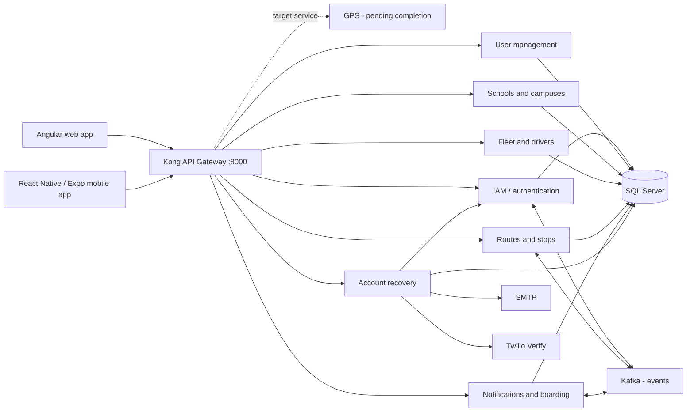
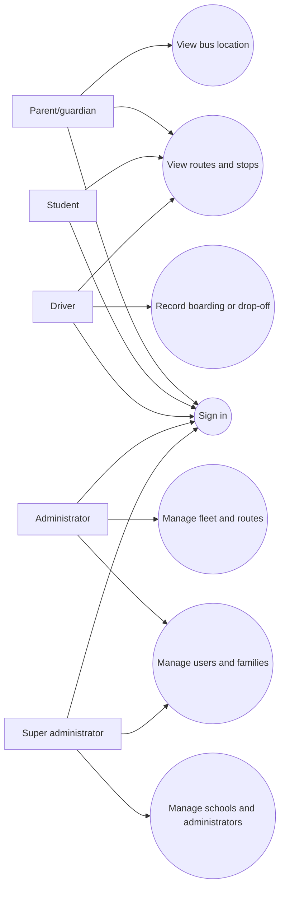
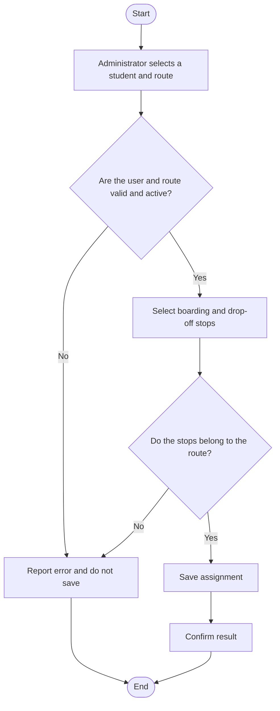
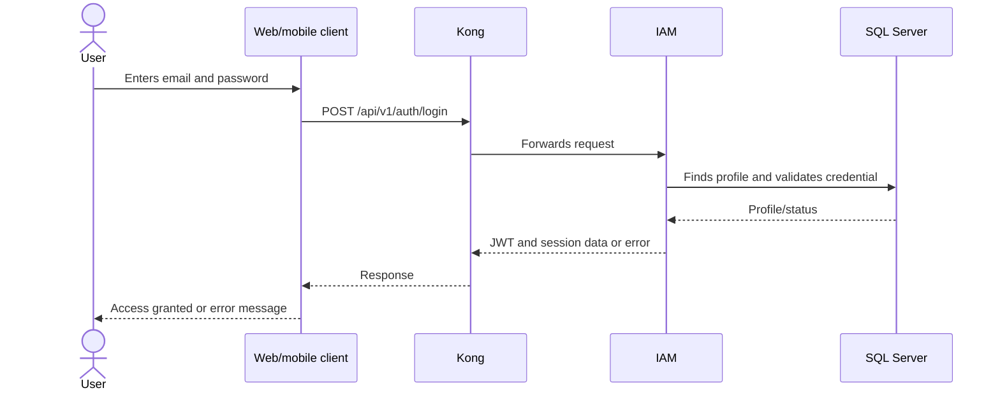
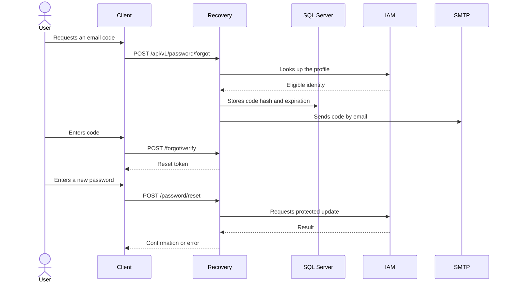
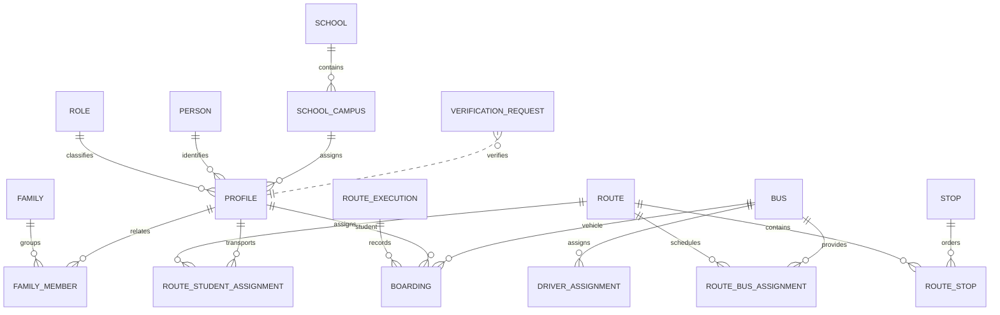

# Guardian Escolar Software Design

**Technical document — APA 7 academic working format**

| Cover page item | Information |
|---|---|
| Project | Guardian Escolar |
| Team members | [Full name of team member 1], [team member 2], [team member 3] |
| Program | Software Analysis and Development (ADSO), cohort 3145556 |
| Institution | National Learning Service (SENA) |
| Instructor | [Instructor's full name] |
| Date | October 13, 2026 |

> **Version control.** Draft prepared from the repositories, design documentation, and configuration files available in the workspace. Before submission, team members must complete the bracketed information and validate implementation statuses against the branch and environment they will present.

## Introduction and objectives

This document describes the purpose, scope, requirements, architecture, processes, data, interfaces, security, and technologies of Guardian Escolar. Its objective is to provide a coherent technical view that explains how the web and mobile applications relate to the services and data persistence.

Evidence is classified into three levels: **defined**, when it appears in the scope, requirements, or architecture decisions; **implemented**, when there is evidence in the code or traceability matrix; and **pending or requiring validation**, when documents indicate work in progress or there is insufficient evidence. Objectives and architecture diagrams alone should not be interpreted as proof that a feature has been deployed.

## Software overview

Guardian Escolar is an academic platform, initially aimed at Neiva, Huila, to support the administration and monitoring of school transportation. It seeks to facilitate coordination among families, students, drivers, and educational institutions through user, school, vehicle, route, stop, assignment, notification, and operational event data.

### Problem and need

Without centralized information, families and institutions find it difficult to determine which route or stop a student is assigned to, learn the status of a trip, and trace events such as boarding, drop-off, or an incident. The system proposes bringing this information together and providing suitable interfaces for administrative tasks and mobile queries.

### Scope

The defined scope includes sign-in and profiles, management of people and families, schools and campuses, fleet, routes and stops, student assignments, and access to transportation information. It also covers boarding and drop-off events, alerts, and vehicle locations. However, the project's traceability matrix marks implementation of the GPS service and real-time location display as pending; therefore, this behavior is not presented here as a completed capability.

Confirmed out-of-scope items include payments, workshop and mechanical maintenance management, academic grade administration, automated emergency response, and a production GPS integration without a defined provider and contract.

### Users and roles

| Role | Defined responsibility |
|---|---|
| Parent/guardian (`Parent` / `Guardian`) | View related students and, depending on available functionality, routes, stops, vehicle status, notifications, and alerts. |
| Student (`Student`) | Be associated with a family and transportation assignments; the scope includes identification and boarding and drop-off events. |
| Driver (`Driver`) | Operate the assigned vehicle and trip and carry out enabled transportation tasks. |
| Administrator (`Admin`) | Manage users and the institution's operational data: families, students, drivers, buses, routes, and stops. |
| Super administrator (`Super Admin`) | Manage administrators and schools and operate with global scope, according to the product design. |

**Role verification note.** The scope documentation and interfaces distinguish five roles. The reviewed SQL seed for `Iam.Role` lists `Admin`, `Student`, `Driver`, and `Parent`; no `Super Admin` role was found in that seed. Therefore, the super administrator is documented as a role defined by the product, but its creation and effective authorization in the backend must be verified before claiming that it is complete.

## System requirements

The project's functional requirements are grouped by domain. Details and traceability are maintained in [functional requirements](./schoo-guardian/sg-docs/04-requirements/functional.md), [user stories](./schoo-guardian/sg-docs/04-requirements/user-stories.md), and the [traceability matrix](./schoo-guardian/sg-docs/04-requirements/traceability-matrix.md); refer to those documents to avoid duplicating catalogs.

| Group | Defined capabilities | Documented status requiring attention |
|---|---|---|
| Identity and users | Create and update accounts, assign roles, and link parents/guardians to students. | The matrix records creation and updates as complete; changing an account's status is partially implemented. |
| Authentication | Sign in, issue JWTs, sign out, and renew credentials. | Sign-in and renewal exist; the matrix notes that RBAC authorization has not been fully applied. |
| Schools | Manage institutions, campuses, courses, and groups. | The service and contracts must be validated in the presentation environment. |
| Fleet and drivers | Manage buses, licenses, and assignments between drivers and vehicles. | The matrix identifies defects or outstanding gaps in fleet operations and profile lookup. |
| Routes | Maintain routes, stops, schedules, and bus and student assignments. | Some features are partial; for example, pending work is documented for schedule writing, unassignment, and trip validations. |
| Transportation and notifications | Record boardings and drop-offs and communicate events to parents/guardians. | The matrix records some parts as complete and others as partial or pending; mobile notifications contain simulated data. |
| Tracking and incidents | Capture and display GPS location and manage signal loss and incidents. | Live GPS and incident handling are pending or require an integration that remains to be confirmed. |

The non-functional requirements described in [non-functional requirements](./schoo-guardian/sg-docs/04-requirements/non-functional.md) include performance, availability, scalability, security, observability, maintainability, portability, and recovery objectives. Among other things, they propose latency thresholds and availability percentages; the traceability matrix indicates that most of these metrics do not yet have recorded automated validation. They should be treated as **design objectives**, not measured results.

### Identified business rules

1. Accounts separate personal data (`Person`) from identity, credentials, and role (`Profile`).
2. Students, drivers, and parents/guardians are associated with an active campus; the school-campus relationship is not interchangeable with the direct assignment of an administrator to a school.
3. A student assignment to a route must reference stops belonging to that route.
4. A driver is assigned to a bus; the driver's route is determined through the bus assigned to the route.
5. Boarding and drop-off are distinct events; according to the functional requirement, a drop-off requires an active boarding.
6. Location, personal data, and minors' data require access controls, data minimization, and authorized processing. Applicable legal obligations should be reviewed with the institution before an actual deployment.

### Technical constraints

- Declared persistence: Microsoft SQL Server, with logical schemas by domain/service.
- Client entry point: Kong API Gateway on port 8000 in development.
- Services and dependencies connect through the external Docker network `sg-services-network`.
- The target architecture documents REST, gRPC, and Kafka events; each integration's availability must be verified against its contract and deployment.
- Separate repositories are used in the root folder for services, database, gateway, and clients.
- PostgreSQL was not identified in the inspected configuration; the configured database is SQL Server.

## Software architecture

### Overview and components

The target architecture uses microservices, events, polyglot services, and a shared gateway. Clients call Kong; the gateway routes requests to services using Docker's internal DNS names. Services persist data in a shared SQL Server instance, and Kafka is intended for asynchronous integration.

The diagram represents the defined architecture and does not certify that all components are active in every execution. The project catalog describes 11 components, including the gateway; the additional account recovery service appears in the repository and gateway configuration, but it has not been reconciled with the catalog's component count. The service and responsibility registry is in the [microservices catalog](./schoo-guardian/sg-docs/09-microservices/service-catalog.md).

### Services and responsibilities

| Service/component | Documented responsibility | Technology/configuration found | Status to consider |
|---|---|---|---|
| Kong API Gateway | Routing and common API entry point. | Kong OSS; declarative file `sg-ms-api-gateway/kong/kong.yml`. | Configuration is versioned; its upstreams must be available. |
| IAM | Authentication, JWTs, profiles, roles, sessions, and internal identity operations. | Java, Spring Boot, and JDBC for SQL Server. | Code and configuration exist; the matrix notes RBAC gaps. |
| User management | People, families, members, and drivers/licenses. | ASP.NET Core/.NET. | Service and tests exist in the repository; validate features against the matrix. |
| School management | Schools and campuses; the catalog also includes courses, groups, and cities. | ASP.NET Core/.NET. | Service and documented central-campus creation rules exist. |
| Fleet/buses | Buses, makes/models, and driver assignments. | ASP.NET Core/.NET; the `sg-ms-fleet` repository implements fleet features. | Execution/contract gaps are identified in the matrix. |
| Routes | Routes, stops, assignments, and trips. | ASP.NET Core/.NET. | Partially implemented according to the traceability matrix. |
| Notifications | Boardings, drop-offs, alerts, and recipients. | The current catalog lists .NET; verify the technology of each branch/version before publishing a definitive inventory. | Some notifications are implemented; several alerts are pending. |
| GPS | Telemetry ingestion and lookup. | The catalog assigns it to Java/Spring Boot; the GPS service does not appear as a standalone Compose service in the inspected root files. | Live GPS tracking is pending according to the matrix. |
| Incidents | Driver or route-related incidents. | .NET in the architecture catalog. | Confirm deployment and endpoints in the code for the version being presented. |
| Auditing | Audit events and errors. | .NET in the architecture catalog. | Confirm deployment in the environment. |
| Configuration | System parameters and policies. | .NET in the architecture catalog. | Confirm deployment in the environment. |
| Information recovery | Password recovery and email/phone changes; uses IAM, SMTP, and Twilio Verify. | ASP.NET Core/.NET, SQL Server, and Compose variables. | Service and flows are described in its README; it should not be confused with IAM. |
| Kafka | Event transport between services. | Apache Kafka 4.1.0 in Compose. | The broker is configured; events must be verified at the producer/consumer level. |
| SQL Server | Shared persistence with schemas organized by service. | SQL Server 2022; Liquibase for migrations. | Migrations are run from [database/docker-compose.yaml](./database/docker-compose.yaml). |

**Design/code discrepancy.** The service inventory is the target model in `sg-docs`, while the existing Compose files and repositories do not expose exactly the same set. The catalog and its statuses should be updated to match the branches actually deployed. The catalog also differs across documents regarding the notification service's technology; this document does not assume that discrepancy has been resolved.

### Communication between frontend, backend, and data

1. Angular and Expo configure an API URL outside the code and send HTTP requests.
2. Kong applies the configured route and forwards the request to a container on `sg-services-network`.
3. IAM validates credentials and issues tokens; protected services must verify identity and permissions for every operation.
4. Services query their data in SQL Server. The design assigns schemas by service; schema changes are managed with Liquibase.
5. Kafka is reserved for asynchronous domain events. gRPC appears in architecture decisions, although its actual use must be verified in the implementations.
6. The recovery service communicates with IAM through internal endpoints protected by `X-Internal-Api-Key`; the integration also uses SMTP email and Twilio Verify for configured operations.

## Process and feature design

### Use cases

The following diagram summarizes the main actors and tasks identified in the scope. “View live location” is included because it is defined in the product, although the traceability matrix marks the GPS integration as pending.

### Activity: assigning a student to a route

The following flow reflects the documented domain rule. Each validation must be confirmed against the endpoint and tests for the version being implemented.

### Authentication and sign-in

The flow is defined and implemented in the client and IAM; role-based authorization should not be considered complete until the matrix, services, and sensitive endpoints have been validated.

### Password recovery

The recovery implementation limits attempts and requests, stores hashes, and must not log passwords or codes. The contract may respond differently depending on whether the account exists; the actual response should be verified in the README and tests for the deployed service.

### Modules and responsibilities

The web app includes public areas, authentication, administration, super-administration, and profile management. The mobile app contains authentication flows and features intended for mobile users; some notification views are described as simulated. The complete navigation map is maintained in the [navigation map](./schoo-guardian/sg-docs/12-ux-ui/navigation-map.md); refer to it rather than duplicating its inventory here.

## Database design

### Conceptual model

The implementation uses SQL Server and Liquibase. The logical data model is organized into schemas; the complete ownership matrix is in the [data ownership matrix](./schoo-guardian/sg-docs/09-microservices/data-ownership-matrix.md).

The entities in the diagram express domain relationships; physical names and exact cardinalities must be confirmed against the current Liquibase changelogs. `VERIFICATION_REQUEST` belongs to the recovery flow, and its relationship with `PROFILE` is conceptual.

### Schemas, keys, and integrity

The design ownership matrix lists `Iam`, `UserManagement`, `School`, `Geographic`, `Notification`, `Bus`, `Route`, `Gps`, `Exceptional`, `Audit`, and `Configuration`. The changelogs found also use the `Fleet` and `Settings` schemas instead of `Bus` and `Configuration`, respectively. The recovery application also creates `ForgotInformation.VerificationRequest`. Identified entities include `Role`, `Profile`, `Person`, `Family`, `FamilyMember`, `School`, `SchoolCampus`, buses, routes, stops, assignments, `RouteExecution`, `Boarding`, alerts, and GPS locations.

Tables use primary keys and foreign-key relationships declared in scripts/changelogs. Examples from the DDL include `Iam.Role.Id`, `Iam.Profile.Id`, `UserManagement.Person.Id`, `School.School.Id`, and `Route.Route.Id` as primary keys; `Role.Name` and `IdentificationNumber` have uniqueness constraints. Role, person, school, and route status values have defined allowed domains. The ownership matrix describes relationships between profile and person, school and campus, route and stop, route and bus, route and student, and boarding event with profile, vehicle, and execution.

User/family, bus/driver, notification/trip, and other foreign keys must be verified in the current changelogs, including nullability, indexes, cascades, and uniqueness. Do not assume that every conceptual rule already has a physical constraint.

> **Open issue:** some architecture documentation describes schema boundaries without cross-schema keys, while another matrix lists foreign keys across schemas. The SQL Server implementation contains cross-domain relationships in migrations. Align ADR-002, the data matrix, and the DDL before presenting this rule as definitive.

## Interface design

The web interface uses Angular 21 and Angular Material. The [navigation map](./schoo-guardian/sg-docs/12-ux-ui/navigation-map.md) defines public pages, sign-in, recovery, administrator and super-administrator dashboards, and management of users, routes, stops, buses, schools, profiles, and data changes. The mobile app uses React Native with Expo; its routes and flows should be reviewed directly in the mobile code.

The web design system documents light and dark themes in blue, green, yellow, and red; Roboto and Segoe UI/Arial typefaces; Material components; spacing from 4 to 32 px; and guidelines for the navigation bar, panels, cards, and forms. The tokens and their values are in the [design system](./schoo-guardian/sg-docs/12-ux-ui/design-system.md); this reference avoids duplicating the palette. The existence of a route or screen does not prove that role permissions are enforced in the backend: that still needs to be verified.

## System security

### Defined or identified controls

- IAM issues and renews tokens and has internal endpoints for profile lookup/update.
- `ms-forgot-information` requires an internal service key to call IAM and handles OTP codes using hashes, expiration, and limits.
- Compose injects configuration and secrets from `.env`; those values must not be published or copied into documentation.
- Services must validate inputs and separate personal data from credentials.
- The authentication policy and ADR are in the [security policy](./schoo-guardian/sg-docs/00-governance/security-policy.md) and [ADR-008 on JWT](./schoo-guardian/sg-docs/05-architecture/decisions/records/ADR-008-jwt-rs256-authentication.md).

### Validations required before delivery

The repository documentation distinguishes target policies from mechanisms that have actually been tested. The traceability matrix marks RBAC as incomplete; permissions must be tested on each service's endpoints, not merely enforced by hiding interface options. Refresh-token storage and revocation, deployed cryptographic configuration, HTTPS outside the local environment, secret rotation, auditing, consent, and processing of minors' data must also be validated. Statutory Law 1581 of 2012 and applicable guidelines should be reviewed with the institution; the official citation is in the academic article.

## Technologies and tools

| Layer | Identified technology |
|---|---|
| Web | Angular 21, TypeScript, Angular Material, RxJS, npm |
| Mobile | React Native 0.86, Expo 57, JavaScript/TypeScript, Expo Location, Expo Notifications |
| .NET backend | .NET / ASP.NET Core 10 in the current services in the `sg-ms-*` line |
| IAM | Java 21 and Spring Boot (version configured in the POM) |
| API Gateway | Kong OSS 3.9 |
| Persistence | Microsoft SQL Server 2022 |
| Migrations | Liquibase 4.29 |
| Messaging | Apache Kafka 4.1.0 |
| Containers | Docker and Docker Compose; shared `sg-services-network` network |
| Geolocation/third parties | Expo Location and maps in clients; SMTP and Twilio Verify for recovery/contact features |
| Version control | Git; branches and conventions are documented in separate repositories |

The table describes identified dependencies/configurations. It is not an exhaustive inventory of every service or evidence that they are all deployed simultaneously.

## Conclusions and cross-references

Guardian Escolar has a product definition, a distributed target architecture, and frontend, backend, and database repositories. Current documentation also identifies significant gaps: role-based authorization, coverage/validation of non-functional requirements, notification integrations, and GPS tracking. Technical decisions must be distinguished from actual implementation status, and each update should be reflected in the code, tests, and traceability matrix.

For the academic analysis, background, and APA references, see [Collaborative working paper](./02-articulo-colaborativo-guardian-escolar.md). To install, configure, and test the environment, see [Implementation procedure](./03-procedimiento-implementacion-guardian-escolar.md). The cited internal files are located in `schoo-guardian/sg-docs`; their detailed contents are not repeated in this document.
