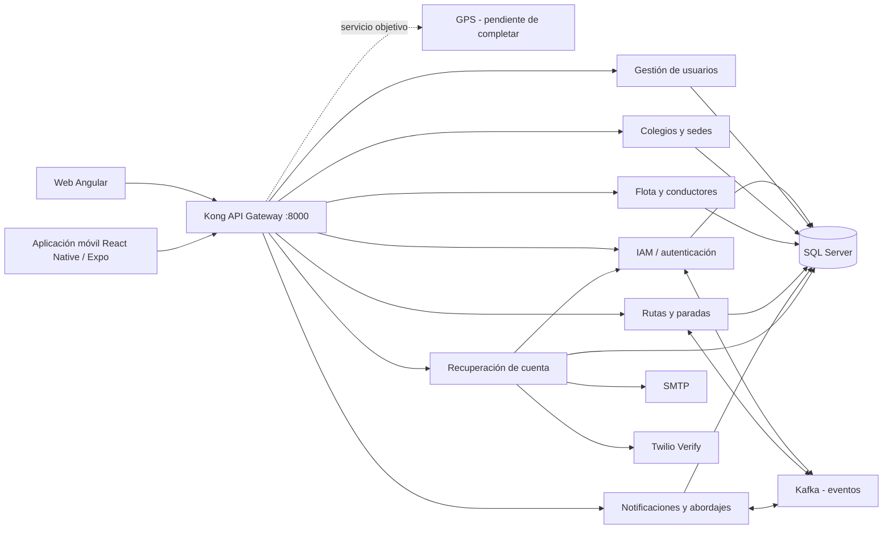
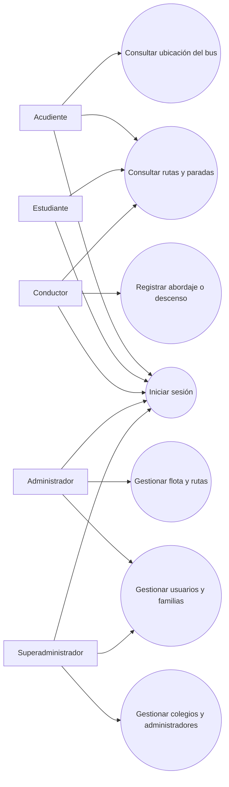
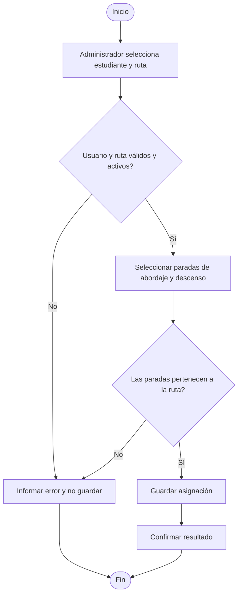
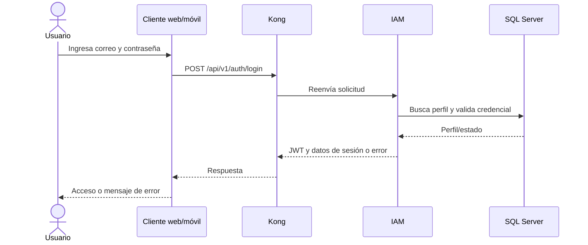
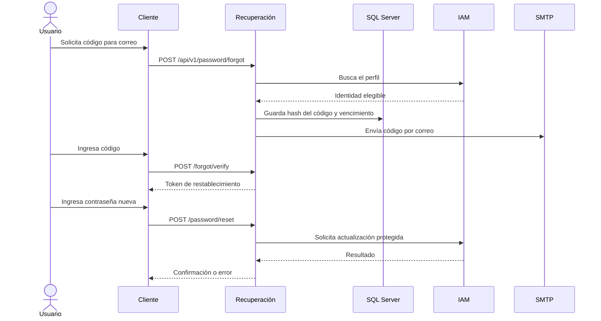
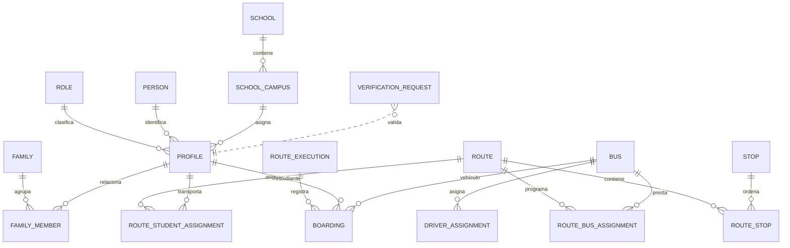

# Diseño de software de Guardian Escolar

**Documento técnico — formato de trabajo académico APA 7**

| Dato de portada | Información |
|---|---|
| Proyecto | Guardian Escolar |
| Integrantes | [Nombre completo del integrante 1], [integrante 2], [integrante 3] |
| Programa | Análisis y Desarrollo de Software (ADSO), ficha 3145556 |
| Institución | Servicio Nacional de Aprendizaje (SENA) |
| Instructor(a) | [Nombre del instructor o instructora] |
| Fecha | 13 de octubre de 2026 |

> **Control de versión.** Borrador elaborado a partir de los repositorios, la documentación de diseño y los archivos de configuración disponibles en el espacio de trabajo. Antes de entregar, los integrantes deben completar los datos entre corchetes y validar los estados de implementación contra la rama y el entorno que presentarán.

## Introducción y objetivos

Este documento describe el propósito, el alcance, los requisitos, la arquitectura, los procesos, los datos, las interfaces, la seguridad y las tecnologías de Guardian Escolar. Su objetivo es ofrecer una vista técnica coherente que permita comprender cómo se relacionan las aplicaciones web y móvil con los servicios y la persistencia.

La evidencia se clasifica en tres niveles: **definido**, cuando aparece en el alcance, los requisitos o las decisiones de arquitectura; **implementado**, cuando existe evidencia en el código o en la matriz de trazabilidad; y **pendiente o por validar**, cuando los documentos señalan trabajo en curso o no existe evidencia suficiente. Los objetivos y diagramas de arquitectura no deben interpretarse por sí solos como prueba de que una funcionalidad está desplegada.

## Descripción general del software

Guardian Escolar es una plataforma académica, orientada inicialmente a Neiva, Huila, para apoyar la administración y el seguimiento del transporte escolar. Busca facilitar la coordinación entre familias, estudiantes, conductores e instituciones educativas mediante datos de usuarios, colegios, vehículos, rutas, paradas, asignaciones, notificaciones y eventos operativos.

### Problema y necesidad

Sin información centralizada, a las familias y a las instituciones les resulta difícil consultar a qué ruta o parada está asignado un estudiante, conocer el estado del recorrido y tener trazabilidad de eventos como el abordaje, el descenso o una novedad. El sistema propone reunir esa información y brindar interfaces adecuadas para tareas administrativas y consultas móviles.

### Alcance

El alcance definido incluye inicio de sesión y perfiles, gestión de personas y familias, colegios y sedes, flota, rutas y paradas, asignaciones de estudiantes y consulta de información del transporte. También contempla eventos de abordaje y descenso, alertas y ubicación de vehículos. La matriz de trazabilidad del proyecto, sin embargo, señala como pendientes la implementación del servicio GPS y la visualización de ubicación en tiempo real; por tanto, ese comportamiento no se presenta aquí como una capacidad ya terminada.

Quedan fuera del alcance confirmado los pagos, la gestión de talleres y mantenimiento mecánico, la administración académica de calificaciones, la respuesta automatizada a emergencias y una integración GPS de producción sin proveedor y contrato definidos.

### Usuarios y roles

| Rol | Responsabilidad definida |
|---|---|
| Acudiente (`Parent` / `Guardian`) | Consultar estudiantes relacionados y, según la funcionalidad disponible, rutas, paradas, estado del vehículo, notificaciones y alertas. |
| Estudiante (`Student`) | Asociarse a una familia y a asignaciones de transporte; el alcance contempla identificación y eventos de abordaje y descenso. |
| Conductor (`Driver`) | Operar el vehículo y el recorrido asignados y atender las tareas de transporte habilitadas. |
| Administrador (`Admin`) | Gestionar usuarios y datos operativos de la institución: familias, estudiantes, conductores, buses, rutas y paradas. |
| Superadministrador (`Super Admin`) | Gestionar administradores y colegios y operar con alcance global, de acuerdo con el diseño de producto. |

**Nota de verificación de roles.** La documentación de alcance y las interfaces distinguen cinco roles. La semilla SQL de `Iam.Role` revisada registra `Admin`, `Student`, `Driver` y `Parent`; no se encontró en esa semilla un rol `Super Admin`. Por ello, el superadministrador se documenta como rol definido en el producto, pero su alta y autorización efectiva en backend deben comprobarse antes de afirmar que están completas.

## Requisitos del sistema

Los requisitos funcionales del proyecto se agrupan por dominio. El detalle y su trazabilidad se mantienen en [requisitos funcionales](./schoo-guardian/sg-docs/04-requirements/functional.md), [historias de usuario](./schoo-guardian/sg-docs/04-requirements/user-stories.md) y [matriz de trazabilidad](./schoo-guardian/sg-docs/04-requirements/traceability-matrix.md); se remite allí para no duplicar catálogos.

| Grupo | Capacidades definidas | Estado documentado que requiere atención |
|---|---|---|
| Identidad y usuarios | Crear y actualizar cuentas, asignar roles y relacionar acudientes con estudiantes. | La matriz registra creación y actualización como terminadas; el cambio de estado de cuenta está parcialmente implementado. |
| Autenticación | Iniciar sesión, emitir JWT, cerrar sesión y renovar credenciales. | Inicio y renovación existen; la matriz advierte que la autorización RBAC no se encuentra completamente aplicada. |
| Colegios | Administrar instituciones, sedes, cursos y grupos. | El servicio y los contratos deben validarse en el entorno de presentación. |
| Flota y conductores | Administrar buses, licencias y asignaciones entre conductores y vehículos. | La matriz señala defectos o brechas pendientes en operaciones de flota y consulta de perfiles. |
| Rutas | Mantener rutas, paradas, horarios y asignaciones de buses y estudiantes. | Hay funciones parciales; por ejemplo, se documentan pendientes en escritura de horarios, desasignación y validaciones de viaje. |
| Transporte y notificaciones | Registrar abordajes y descensos y comunicar eventos a los acudientes. | La matriz registra partes completadas y otras parciales o pendientes; las notificaciones móviles contienen datos simulados. |
| Seguimiento e incidencias | Capturar y presentar ubicación GPS, gestionar pérdida de señal e incidencias. | GPS en vivo e incidencias están pendientes o requieren una integración por confirmar. |

Los requisitos no funcionales descritos en [requisitos no funcionales](./schoo-guardian/sg-docs/04-requirements/non-functional.md) incluyen objetivos de rendimiento, disponibilidad, escalabilidad, seguridad, observabilidad, mantenibilidad, portabilidad y recuperación. Allí se proponen, entre otros, umbrales de latencia y porcentajes de disponibilidad; la matriz de trazabilidad indica que la mayoría de esas métricas todavía no tiene validación automatizada registrada. Deben tratarse como **objetivos de diseño**, no como resultados medidos.

### Reglas de negocio identificadas

1. Las cuentas se separan entre datos personales (`Person`) e identidad, credenciales y rol (`Profile`).
2. Estudiantes, conductores y acudientes se relacionan con una sede activa; la relación escuela-sede no es intercambiable con la asignación directa de un administrador a una escuela.
3. Una asignación de estudiante a una ruta debe referenciar paradas de esa ruta.
4. La asignación de conductor se hace al bus; la ruta del conductor se obtiene por el bus asignado a la ruta.
5. Un abordaje y un descenso son eventos distintos; el descenso exige un abordaje activo según el requisito funcional.
6. La ubicación, los datos personales y los datos de menores requieren controles de acceso, minimización y tratamiento autorizado. La obligación legal aplicable debe revisarse con la institución antes de un despliegue real.

### Restricciones técnicas

- Persistencia declarada: Microsoft SQL Server, con esquemas lógicos por dominio/servicio.
- Entrada desde clientes: Kong API Gateway en el puerto 8000 en desarrollo.
- Servicios y dependencias se conectan mediante la red Docker externa `sg-services-network`.
- La arquitectura objetivo documenta REST, gRPC y eventos Kafka; la disponibilidad de cada integración debe comprobarse por contrato y despliegue.
- Se utilizan repositorios separados en la carpeta raíz para servicios, base de datos, gateway y clientes.
- No se identificó PostgreSQL en la configuración inspeccionada; la base configurada es SQL Server.

## Arquitectura del software

### Vista general y componentes

La arquitectura objetivo es de microservicios con eventos, servicios políglotas y un gateway común. Los clientes llaman a Kong; el gateway enruta a los servicios por nombre DNS interno de Docker. Los servicios persisten en una instancia SQL Server compartida, y Kafka se contempla para integración asíncrona.

El diagrama representa la arquitectura definida y no certifica que todos los componentes estén activos en cada ejecución. El catálogo del proyecto describe 11 componentes contando el gateway; el servicio adicional de recuperación de información aparece en el repositorio y en la configuración del gateway, pero no está armonizado en el conteo del catálogo. El registro de servicios y sus responsabilidades está en el [catálogo de microservicios](./schoo-guardian/sg-docs/09-microservices/service-catalog.md).

### Servicios y responsabilidades

| Servicio/componente | Responsabilidad documentada | Tecnología/configuración localizada | Estado que se debe considerar |
|---|---|---|---|
| Kong API Gateway | Enrutamiento y entrada común de API. | Kong OSS; archivo declarativo `sg-ms-api-gateway/kong/kong.yml`. | Configuración versionada; requiere que sus upstreams estén disponibles. |
| IAM | Autenticación, JWT, perfiles, roles, sesiones y operaciones internas de identidad. | Java, Spring Boot y JDBC para SQL Server. | Hay código y configuración; la matriz advierte brechas en RBAC. |
| Gestión de usuarios | Personas, familias, integrantes y conductores/licencias. | ASP.NET Core/.NET. | Hay servicio y pruebas en el repositorio; validar funciones con la matriz. |
| Gestión escolar | Colegios y sedes; el catálogo también contempla cursos, grupos y ciudades. | ASP.NET Core/.NET. | Hay servicio y reglas de creación de sede central documentadas. |
| Flota/buses | Buses, marcas/modelos y asignaciones de conductores. | ASP.NET Core/.NET; el repositorio `sg-ms-fleet` implementa funciones de flota. | Brechas de ejecución/contrato señaladas en la matriz. |
| Rutas | Rutas, paradas, asignaciones y recorridos. | ASP.NET Core/.NET. | Implementación parcial según matriz de trazabilidad. |
| Notificaciones | Abordajes, descensos, alertas y destinatarios. | El catálogo actual registra .NET; verificar tecnología de cada rama/versionado antes de publicar un inventario definitivo. | Algunas notificaciones están hechas; varias alertas están pendientes. |
| GPS | Ingesta y consulta de telemetría. | El catálogo lo asigna a Java/Spring Boot; el servicio GPS no aparece como un Compose independiente en los archivos raíz inspeccionados. | Seguimiento GPS en vivo pendiente según la matriz. |
| Excepcionales | Novedades de uso del conductor o de la ruta. | .NET en el catálogo de arquitectura. | Confirmar despliegue y endpoints en el código de la versión presentada. |
| Auditoría | Eventos de auditoría y errores. | .NET en el catálogo de arquitectura. | Confirmar despliegue en el entorno. |
| Configuración | Parámetros y políticas del sistema. | .NET en el catálogo de arquitectura. | Confirmar despliegue en el entorno. |
| Recuperación de información | Recuperación de contraseña y cambios de correo/teléfono; usa IAM, SMTP y Twilio Verify. | ASP.NET Core/.NET, SQL Server y variables Compose. | Servicio y flujos descritos en su README; no debe confundirse con IAM. |
| Kafka | Transporte de eventos entre servicios. | Apache Kafka 4.1.0 en Compose. | El broker está configurado; el evento debe verificarse por productor/consumidor. |
| SQL Server | Persistencia compartida con esquemas organizados por servicio. | SQL Server 2022; Liquibase para migraciones. | Las migraciones se ejecutan desde [database/docker-compose.yaml](./database/docker-compose.yaml). |

**Diferencia de diseño y código.** El inventario de servicios es el modelo objetivo de `sg-docs`, mientras que los Compose y repositorios existentes no exponen exactamente el mismo conjunto. Deben actualizarse el catálogo y sus estados para que coincidan con las ramas realmente desplegadas. El catálogo también varía entre documentos respecto de la tecnología del servicio de notificaciones; se evita asumir que esa discrepancia está resuelta.

### Comunicación entre frontend, backend y datos

1. Angular y Expo configuran una URL de API externa al código y envían solicitudes HTTP.
2. Kong aplica la ruta configurada y reenvía la solicitud a un contenedor en `sg-services-network`.
3. IAM valida credenciales y entrega tokens; los servicios protegidos deben verificar la identidad y los permisos de cada operación.
4. Los servicios consultan sus datos en SQL Server. El diseño asigna esquemas por servicio; los cambios de estructura se administran con Liquibase.
5. Kafka se reserva para eventos de dominio asíncronos. gRPC figura en decisiones de arquitectura, aunque su uso efectivo se debe verificar en las implementaciones.
6. Recuperación se comunica con IAM mediante endpoints internos protegidos por `X-Internal-Api-Key`; la integración también utiliza correo SMTP y Twilio Verify para las operaciones configuradas.

## Diseño de procesos y funcionalidades

### Casos de uso

El siguiente diagrama resume los actores y tareas principales identificados en el alcance. «Consultar ubicación en vivo» se incluye porque está definido en el producto, aunque la matriz de trazabilidad marca la integración GPS como pendiente.

### Actividad: asignación de estudiante a una ruta

El flujo siguiente refleja la regla de dominio documentada. La confirmación de cada validación debe cotejarse con el endpoint y las pruebas de la versión que se implemente.

### Autenticación e inicio de sesión

El flujo está definido e implementado en el cliente y en IAM; no se considera terminado el control de autorización por roles hasta validar la matriz, los servicios y los endpoints sensibles.

### Recuperación de contraseña

La implementación de recuperación limita intentos y solicitudes, conserva hashes y no debe registrar contraseñas ni códigos. El contrato puede responder de forma distinta según exista la cuenta; la respuesta real debe verificarse en el README y en las pruebas del servicio desplegado.

### Módulos y responsabilidades

La web incluye áreas públicas, autenticación, administración, superadministración y perfil. La app móvil contiene flujos de autenticación y funcionalidades orientadas al usuario móvil; algunas vistas de notificaciones se describen como simuladas. El mapa completo de navegación se mantiene en el [mapa de navegación](./schoo-guardian/sg-docs/12-ux-ui/navigation-map.md); se remite a él en vez de copiar su inventario.

## Diseño de la base de datos

### Modelo conceptual

La implementación utiliza SQL Server y Liquibase. El modelo de datos lógico se organiza en esquemas; la matriz de propiedad completa está en la [matriz de propiedad de datos](./schoo-guardian/sg-docs/09-microservices/data-ownership-matrix.md).

Las entidades del diagrama expresan relaciones de dominio; los nombres físicos y cardinalidades exactas deben confirmarse contra los changelogs Liquibase vigentes. `VERIFICATION_REQUEST` pertenece al flujo de recuperación y la relación representada con `PROFILE` es conceptual.

### Esquemas, claves e integridad

La matriz de propiedad del diseño enumera `Iam`, `UserManagement`, `School`, `Geographic`, `Notification`, `Bus`, `Route`, `Gps`, `Exceptional`, `Audit` y `Configuration`. Los changelogs encontrados usan también los esquemas `Fleet` y `Settings` en lugar de `Bus` y `Configuration`, respectivamente. La aplicación de recuperación crea además `ForgotInformation.VerificationRequest`. Entidades identificadas incluyen `Role`, `Profile`, `Person`, `Family`, `FamilyMember`, `School`, `SchoolCampus`, buses, rutas, paradas, asignaciones, `RouteExecution`, `Boarding`, alertas y ubicaciones GPS.

Las tablas usan claves primarias y relaciones foráneas declaradas en scripts/changelogs. Como ejemplos del DDL, `Iam.Role.Id`, `Iam.Profile.Id`, `UserManagement.Person.Id`, `School.School.Id` y `Route.Route.Id` son claves primarias; `Role.Name` e `IdentificationNumber` tienen restricciones de unicidad. El estado de rol, persona, colegio y ruta incluye dominios permitidos. La matriz de propiedad describe relaciones entre perfil y persona, escuela y sede, ruta y parada, ruta y bus, ruta y estudiante, y evento de abordaje con perfil, vehículo y ejecución.

Las FKs de usuario/familia, bus/conductor, notificación/recorrido y demás relaciones deben verificarse en los changelogs vigentes, incluyendo nulabilidad, índices, cascadas y unicidad. No se debe asumir que todas las reglas conceptuales tienen ya una restricción física.

> **Punto por resolver:** hay documentación de arquitectura que describe límites de esquema sin llaves cruzadas y otra matriz que lista llaves foráneas entre esquemas. La implementación de SQL Server contiene relaciones entre dominios en migraciones. Alinear ADR-002, matriz de datos y DDL antes de presentar esa regla como definitiva.

## Diseño de interfaces

La interfaz web usa Angular 21 y Angular Material. El [mapa de navegación](./schoo-guardian/sg-docs/12-ux-ui/navigation-map.md) define páginas públicas, inicio de sesión, recuperación, paneles de administrador y superadministrador, gestión de usuarios, rutas, paradas, buses, colegios, perfil y cambios de datos. La app móvil usa React Native con Expo; sus rutas y flujos deben revisarse directamente en el código móvil.

El sistema de diseño web documenta temas claros y oscuros en azul, verde, amarillo y rojo, tipografías Roboto y Segoe UI/Arial, componentes Material, espaciado de 4 a 32 px y criterios para barra de navegación, paneles, tarjetas y formularios. Los tokens y sus valores están en el [sistema de diseño](./schoo-guardian/sg-docs/12-ux-ui/design-system.md); esta referencia evita duplicar la paleta. La presencia de una ruta o pantalla no demuestra que el permiso del rol se aplique en backend: esa verificación sigue siendo necesaria.

## Seguridad del sistema

### Controles definidos o localizados

- IAM emite y renueva tokens y tiene endpoints internos para consulta/actualización de perfil.
- `ms-forgot-information` exige una clave de servicio interna para llamar a IAM y maneja códigos OTP con hash, vencimiento y límites.
- Compose inyecta configuración y secretos desde `.env`; esos valores no deben publicarse ni copiarse a documentación.
- Los servicios deben validar entradas y separar datos personales de credenciales.
- La política y el ADR de autenticación se encuentran en la [política de seguridad](./schoo-guardian/sg-docs/00-governance/security-policy.md) y el [ADR-008 sobre JWT](./schoo-guardian/sg-docs/05-architecture/decisions/records/ADR-008-jwt-rs256-authentication.md).

### Validaciones necesarias antes de una entrega

La documentación del repositorio diferencia políticas objetivo de mecanismos efectivamente probados. La matriz de trazabilidad marca RBAC incompleto; se deben probar permisos en endpoints de cada servicio, no solo ocultar opciones en la interfaz. También se deben validar almacenamiento y revocación de refresh tokens, configuración criptográfica desplegada, HTTPS fuera del entorno local, rotación de secretos, auditoría, consentimiento y tratamiento de datos de menores. La Ley Estatutaria 1581 de 2012 y los lineamientos aplicables deben ser revisados con la institución; la cita oficial está en el artículo académico.

## Tecnologías y herramientas

| Capa | Tecnología identificada |
|---|---|
| Web | Angular 21, TypeScript, Angular Material, RxJS, npm |
| Móvil | React Native 0.86, Expo 57, JavaScript/TypeScript, Expo Location, Expo Notifications |
| Backend .NET | .NET / ASP.NET Core 10 en los servicios actuales de la línea `sg-ms-*` |
| IAM | Java 21 y Spring Boot (versión configurada en el POM) |
| API Gateway | Kong OSS 3.9 |
| Persistencia | Microsoft SQL Server 2022 |
| Migraciones | Liquibase 4.29 |
| Mensajería | Apache Kafka 4.1.0 |
| Contenedores | Docker y Docker Compose; red compartida `sg-services-network` |
| Geolocalización/terceros | Expo Location y mapas en clientes; SMTP y Twilio Verify en funciones de recuperación/contacto |
| Control de versiones | Git; las ramas y convenciones se documentan en repositorios separados |

La tabla describe dependencias/configuraciones localizadas, no un inventario exhaustivo de cada servicio ni evidencia de que todos estén desplegados a la vez.

## Conclusiones y referencias cruzadas

Guardian Escolar cuenta con una definición de producto, una arquitectura objetivo distribuida y repositorios de frontend, backend y base de datos. La documentación vigente identifica también brechas importantes: autorización por roles, cobertura/validación de requisitos no funcionales, integraciones de notificación y seguimiento GPS. La decisión técnica debe distinguirse del estado real de implementación, y cada avance debería actualizar código, pruebas y matriz de trazabilidad.

Para el análisis académico, antecedentes y referencias APA, véase [Artículo de trabajo colaborativo](./02-articulo-colaborativo-guardian-escolar.md). Para instalar, configurar y probar el entorno, véase [Procedimiento de implementación](./03-procedimiento-implementacion-guardian-escolar.md). Los archivos internos citados se encuentran en `schoo-guardian/sg-docs`; su contenido detallado no se replica en este documento.
