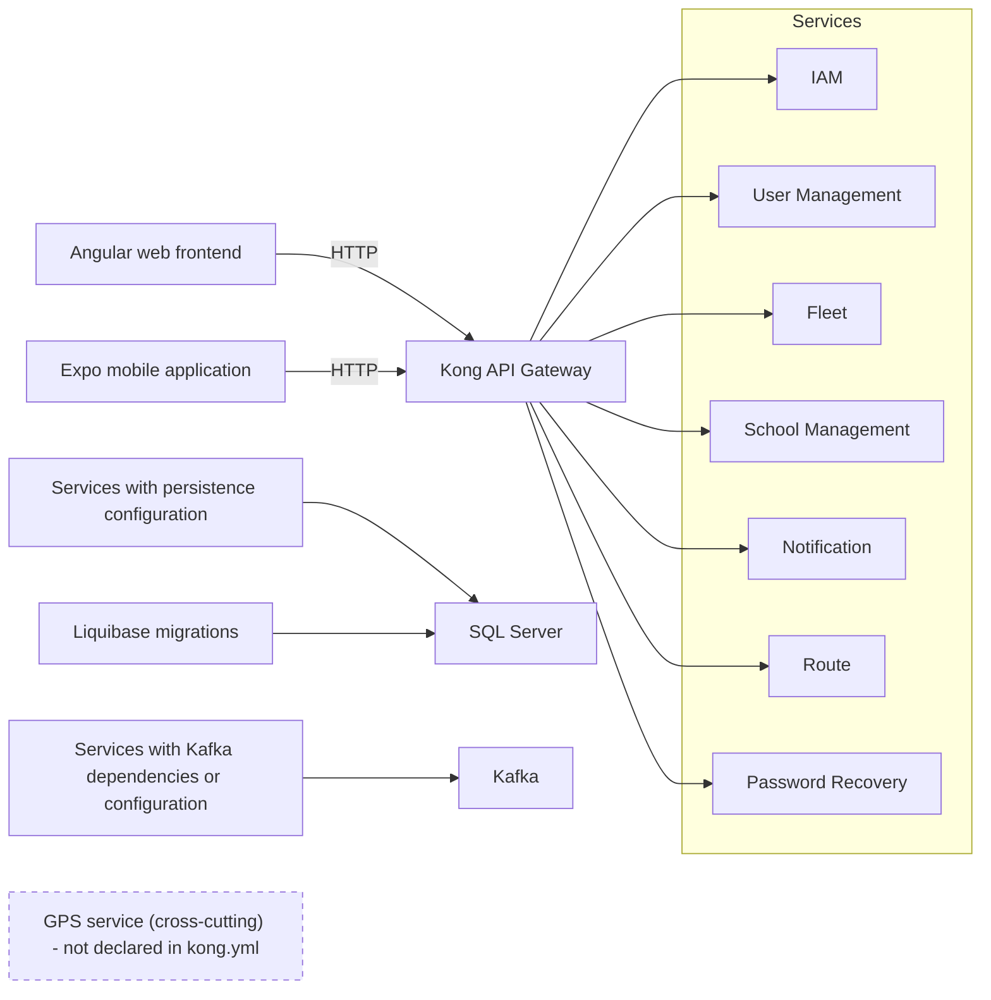

# Code Artifacts — School Guardian

Code Artifacts — School Guardian  
 Juan Pablo Chala, Johan Smith Santamaria, and Sharik Dayanna Rojas  
Servicio Nacional de Aprendizaje (SENA) — National Learning Service  
Software Analysis and Development (ADSO)  
3145556  
Neiva, Colombia   

---

## Table of Contents

- [1. Introduction](#1-introduction)
- [2. Objective and Scope of the Inventory](#2-objective-and-scope-of-the-inventory)
  - [2.1. General Objective](#21-general-objective)
  - [2.2. Specific Objectives](#22-specific-objectives)
  - [2.3. Scope](#23-scope)
- [3. General System Architecture](#3-general-system-architecture)
- [4. Inventory of Repositories and Modules](#4-inventory-of-repositories-and-modules)
- [5. Technologies, Languages, Frameworks, and Dependencies](#5-technologies-languages-frameworks-and-dependencies)
- [6. Folder Structure and Relevant Components](#6-folder-structure-and-relevant-components)
- [7. Angular Web Frontend Artifacts](#7-angular-web-frontend-artifacts)
- [8. React Native/Expo Mobile Application Artifacts](#8-react-nativeexpo-mobile-application-artifacts)
- [9. .NET Microservice Artifacts](#9-net-microservice-artifacts)
- [10. Java/Spring Boot Microservice Artifacts](#10-javaspring-boot-microservice-artifacts)
- [11. Kong API Gateway and API Contracts](#11-kong-api-gateway-and-api-contracts)
- [12. Database, SQL, and Liquibase](#12-database-sql-and-liquibase)
  - [12.1. Schemas Identified](#121-schemas-identified)
  - [12.2. Persistence Artifacts](#122-persistence-artifacts)
- [13. Kafka, Events, and Communication](#13-kafka-events-and-communication)
  - [13.1. Declared Topics](#131-declared-topics)
  - [13.2. Kafka Artifacts](#132-kafka-artifacts)
- [14. GPS Backend and Positions](#14-gps-backend-and-positions)
- [15. Infrastructure, Docker, and Configuration](#15-infrastructure-docker-and-configuration)
- [16. Existing Automated Tests](#16-existing-automated-tests)
- [17. Technical Documentation and Diagrams](#17-technical-documentation-and-diagrams)
- [18. Traceability Matrix Between Needs and Artifacts](#18-traceability-matrix-between-needs-and-artifacts)
- [19. Findings, Duplications, and Inconsistencies](#19-findings-duplications-and-inconsistencies)
- [20. Limitations of the Audit](#20-limitations-of-the-audit)
- [21. Conclusions](#21-conclusions)
- [22. Corrections Made During the Documentation Review](#22-corrections-made-during-the-documentation-review)
  - [22.1. Corrections to the Original Inventory](#221-corrections-to-the-original-inventory)
  - [22.2. Editorial Adjustments in the APA 7 Version](#222-editorial-adjustments-in-the-apa-7-version)
- [23. Unverifiable Data](#23-unverifiable-data)
- [24. Pending Evidence to Validate Operation](#24-pending-evidence-to-validate-operation)
- [25. Files Consulted](#25-files-consulted)

---

## 1. Introduction

Guardian Escolar (School Guardian) is a platform for managing and monitoring school transportation. Its purpose is to support the administration of students, guardians, drivers, vehicles, schools, and routes, as well as to provide functionality related to authentication, GPS tracking, boarding, and notifications.

The project workspace contains client applications, microservices, an API gateway, messaging mechanisms, database scripts, and technical documentation.

This document presents an inventory of the technical artifacts identified in the project files. Code artifacts are understood to include source files, components, controllers, services, models, configuration files, SQL scripts, automated tests, and other resources used to develop and maintain the software.

The expression “implemented in code” indicates that an artifact exists that contains logic or configuration related to a given functionality. It does not necessarily mean that the functionality has been executed, tested, or fully validated.

## 2. Objective and Scope of the Inventory

### 2.1. General Objective

To document the technical artifacts available for Guardian Escolar by describing their organization, technologies, responsibilities, and verification status, in order to facilitate software maintenance and support the preparation of the technical deliverables of the ADSO project.

### 2.2. Specific Objectives

- Identify the repositories and modules that make up the project.
- Describe the declared technologies, languages, frameworks, and dependencies.
- Identify the main files and components of the web and mobile applications.
- Document the microservices, their responsibilities, and the API routes identified.
- Describe the database, infrastructure, messaging, and configuration artifacts.
- Identify the existing automated tests and distinguish their existence from their execution.
- Record inconsistencies, duplications, and technical risks that require follow-up.
- Establish a relationship between the needs of the system and the artifacts that provide evidence of their implementation.

### 2.3. Scope

The inventory covers 15 Git repositories identified in the workspace:

- Angular web application.
- Mobile application developed with Expo and React Native.
- Business services developed with .NET.
- Cross-cutting identity (IAM) and GPS services developed with Java and Spring Boot.
- Kong API Gateway.
- Apache Kafka messaging infrastructure.
- SQL Server scripts and Liquibase migrations.
- Technical documentation, diagrams, and automated tests.

The scope does not include certification of the overall operation of the system. No builds, migrations, full integration tests, or deployments were executed during the audit described.

## 3. General System Architecture

Guardian Escolar presents a distributed architecture that integrates client applications, backend services, data persistence, and communication mechanisms.

Figure 1 summarizes the relationships identified in the code and configuration.

**Figure 1**

*Declared General Architecture of Guardian Escolar*

*Note.* Graphical representation of the text diagram in the original document. The diagram represents a general view of the declared architecture. It does not imply that all connections are operational or that all services communicate directly with one another.

Kong contains routing configuration toward certain internal services. SQL Server and Liquibase appear in the infrastructure and migration files. Kafka has broker configuration and topic declarations.

GPS is considered a separate cross-cutting service. Its publication through Kong was not confirmed, because the reviewed `kong.yml` file does not declare a GPS service.

Architecture status: code and configuration artifacts exist that describe the architecture; its overall operation has not been validated through execution tests.

## 4. Inventory of Repositories and Modules

Table 1 summarizes the repositories identified and their observable responsibilities.

**Table 1**

*Repositories Identified in the Workspace*

| Repository | Type | Identified responsibility | Status |
| --- | --- | --- | --- |
| `broker-kafka` | Infrastructure | Kafka configuration and topic creation | Implemented in configuration |
| `Guardian Escolar` | Monorepo | Web frontend, mobile application, historical GPS, and documents | Implemented in code |
| `sg-db` | Database | SQL Server, Liquibase, DDL, and DML | Implemented in scripts |
| `sg-documentation` | Documentation | Requirements, design, technical proposal, testing, manuals, and ACPM | Designed/documented |
| `sg-ms-api-gateway` | Transversal | Kong configuration and API routes | Implemented in configuration |
| `sg-ms-configuration` | Transversal | README documentation; no observable implementation in the review | Partially implemented |
| `sg-ms-exceptional` | Transversal | Initial structure of an exceptions service in .NET | Partially implemented |
| `sg-ms-fleet` | Business | Management of buses, vehicles, drivers, and associated GPS devices | Implemented in code |
| `sg-ms-forgot-information` | Transversal | Access recovery and information updates | Implemented in code |
| `sg-ms-gps` | Transversal | GPS position queries and tests | Implemented in code |
| `sg-ms-iam` | Transversal | Authentication, profiles, JWT, and terms | Implemented in code |
| `sg-ms-notification` | Business/cross-cutting | Scanning, device tokens, and notifications | Implemented in code |
| `sg-ms-route` | Business | Management of routes, stops, assignments, and trips | Implemented in code |
| `sg-ms-school-management` | Business | Management of schools and campuses | Implemented in code |
| `sg-ms-user-management` | Business | Management of persons, families, students, guardians, and drivers | Implemented in code |

The classification is based on the artifacts identified. The existence of a repository does not by itself demonstrate that the corresponding service is deployed or available.

## 5. Technologies, Languages, Frameworks, and Dependencies

The technologies listed in Table 2 correspond to the versions declared in the configuration files reviewed. They do not necessarily represent the versions actually installed or run in an operating environment.

**Table 2**

*Technologies and Declared Versions*

| Technology | Declared version | Evidence file | Status |
| --- | --- | --- | --- |
| Angular | ^21.2.9 | `Guardian Escolar/dvlp-front/dvlp-web/package.json` | Declared in manifest |
| TypeScript (web) | ~5.9.2 | `dvlp-web/package.json` | Declared in manifest |
| Expo | ~57.0.27 | `dvlp-movil/guardian-escolar/package.json` | Declared in manifest |
| React (mobile) | 19.2.3 | `dvlp-movil/guardian-escolar/package.json` | Declared in manifest |
| React Native | 0.86.3 | `dvlp-movil/guardian-escolar/package.json` | Declared in manifest |
| TypeScript (mobile) | ~6.0.3 | `dvlp-movil/guardian-escolar/package.json` | Declared in manifest |
| .NET | net10.0 | `*.csproj` files of the microservices | Declared in manifests |
| Java | 21 | POM files of IAM, GPS, and historical GPS | Declared in manifests |
| Spring Boot | 4.1.1 | Parent POM of IAM and GPS | Declared in manifests |
| SQL Server | Image 2022-latest | `sg-db/docker-compose.yaml` | Declared in configuration |
| Apache Kafka | Image apache/kafka:4.1.0 | `broker-kafka/docker-compose.yml` | Declared in configuration |
| Kong | Image kong:3.9 | `sg-ms-api-gateway/docker-compose.yml` | Declared in configuration |
| Liquibase | Image liquibase:4.29 | `sg-db/docker-compose.yaml` | Declared in configuration |

Dependencies and mechanisms related to JWT, BCrypt, gRPC, Kafka, and Expo SecureStore are also identified. Their effective use must be verified by reviewing the specific code and, where applicable, through testing.

Historical documentation that mentions PostgreSQL, MySQL, or Flutter must be treated as documentation from earlier stages. The current configuration identified uses SQL Server, Angular, and Expo/React Native. Historical documents should be kept as background material, but they should not be presented as the definitive description of the current architecture.

## 6. Folder Structure and Relevant Components

The organization of the code makes it possible to distinguish interface components, business logic, infrastructure, and persistence resources, as shown in Table 3.

**Table 3**

*Folder Structure and Relevant Components*

| Repository or module | Internal path | Main artifacts | Status |
| --- | --- | --- | --- |
| Web | `dvlp-web/src/app/core` | HTTP services, authentication, and utilities | Implemented in code |
| Web | `dvlp-web/src/app/features` | Public screens, profile, administration, and super-administration | Implemented in code |
| Mobile | `guardian-escolar/src/core` | Services, configuration, validation, and hooks | Implemented in code |
| Mobile | `guardian-escolar/src/features` | Login, profile, home, QR, GPS, and navigation | Implemented in code |
| .NET services | `src/<servicio>.Api` | Controllers, application, infrastructure, and entities | Implemented in code |
| .NET services | `tests/<servicio>.Tests` | Automated tests | Tests exist |
| Java services | `src/main/java` | Domain, DTOs, use cases, and infrastructure | Implemented in code |
| Database | `01-ddl`, `02-dml`, `changelog` | Schemas, tables, foreign keys, indexes, and initial data | Implemented in scripts |
| Gateway | `kong/kong.yml` | Services, routes, CORS, and request rate limiting | Implemented in configuration |

Internal paths must be interpreted within the corresponding repository. Wildcards such as `**` represent groups of files, not an individual path.

## 7. Angular Web Frontend Artifacts

The web application uses Angular and organizes its components into functional areas, shared services, and infrastructure elements (see Table 4).

**Table 4**

*Angular Web Frontend Artifacts*

| Artifact | Repository and relative path | Responsibility | Status |
| --- | --- | --- | --- |
| Entry point | `Guardian Escolar/dvlp-front/dvlp-web/src/main.ts` | Angular startup through `bootstrapApplication` | Implemented in code |
| Root application | `dvlp-web/src/app/app.ts` | Root component and navigation configuration | Implemented in code |
| Core services | `dvlp-web/src/app/core/services/**` | HTTP communication and domain services | Implemented in code |
| Interceptors and HTTP handling | `dvlp-web/src/app/core/http/**` | Handling of HTTP requests and responses | Implemented in code |
| Administration | `dvlp-web/src/app/features/admin/**` | User, bus, route, and stop functionality | Implemented in code |
| Super-administration | `dvlp-web/src/app/features/superadmin/**` | Management of schools and administrators | Implemented in code |
| Profile | `dvlp-web/src/app/features/profile/**` | Password, email, phone, and profile information functionality | Implemented in code |
| Angular tests | `dvlp-web/src/**/*.spec.ts` | Tests of services, views, and components | Existing; not executed |

The folders and files identified make it possible to document the structure of the frontend. The availability of tests does not demonstrate that the screens or services have passed a test run.

## 8. React Native/Expo Mobile Application Artifacts

The mobile application is developed with Expo and React Native. Its artifacts, summarized in Table 5, include application initialization, navigation, authentication, configuration, and functional screens.

**Table 5**

*React Native/Expo Mobile Application Artifacts*

| Artifact | Repository and relative path | Responsibility | Status |
| --- | --- | --- | --- |
| Entry point | `Guardian Escolar/dvlp-front/dvlp-movil/guardian-escolar/index.js` | Application registration through `registerRootComponent` | Implemented in code |
| Root application | `guardian-escolar/App.js` | Navigation and global providers | Implemented in code |
| Login | `src/features/auth/views/Login/Login.jsx` | Form for email, password, and acceptance of terms | Implemented in code |
| Authentication | `src/core/services/authService.js` | Login, refresh, and logout requests and session management | Implemented in code |
| Roles | `src/core/config/roles/roleConfig.js` | Mapping of the `Student`, `Driver`, and `Parent` roles | Implemented in code |
| GPS | `src/core/config/gps.js` | Configuration of URL, IMEI, and polling interval | Implemented in code |
| Profile | `src/features/profile/**` | Personal data, family, security, privacy, and appearance | Implemented in code |
| Tests | `src/core/services/authService.test.mjs`, `scripts/*.test.mjs` | Authentication tests and network scripts | Existing; not executed |

During the audit described, no tests of the mobile application were executed. Therefore, the presence of the artifacts is not evidence that authentication, navigation, GPS, or communication with the backend work as a whole.

## 9. .NET Microservice Artifacts

.NET services contain controllers and backend components oriented to the management of fleet, routes, schools, users, information recovery, and notifications (see Table 6).

**Table 6**

*Controllers and Routes of the .NET Microservices*

| Service | Controllers identified | Routes declared per controller | Status |
| --- | --- | --- | --- |
| Fleet | `BusController.cs` `GpsDeviceController.cs` `VehicleTypeController.cs` | `api/buses` `api/gps-devices` `api/vehicle-types` | Implemented in code |
| Route | `RouteController.cs` `StopController.cs` `TripController.cs` `RouteAssignmentController.cs` `CityController.cs` | `api/routes` `api/stops` `api/trips` `api/cities` | Implemented in code |
| School Management | `SchoolController.cs` | `api/v1/schools` | Implemented in code |
| User Management | `AdminController.cs` `DriverController.cs` `ParentController.cs` `StudentController.cs` `FamilyController.cs` `DriverLicenseController.cs` | `api/admins` `api/drivers` `api/parents` `api/students` `api/families` `api/driver-licenses` | Implemented in code |
| Forgot Information | `Password`, `EmailChange`, and `PhoneChange` controllers | `api/v1/password` `api/v1/email/change` `api/v1/phone/change` | Implemented in code |
| Notification | `NotificationController.cs` | `api/v1/notifications` | Implemented in code |
| Exceptional | `ms-exceptional.Api.csproj` and initial service structure | Functional catalog pending verification | Partially implemented |

Controllers are artifacts that make it possible to identify the declared routes and operations. However, the existence of CRUD methods does not demonstrate that all use cases are complete, that the business rules are correct, or that the services are available at runtime.

## 10. Java/Spring Boot Microservice Artifacts

Java and Spring Boot are used in the identity and GPS services identified in the workspace (see Table 7).

**Table 7**

*Java/Spring Boot Microservice Artifacts*

| Service | Artifact | Relative path | Responsibility | Status |
| --- | --- | --- | --- | --- |
| IAM | Authentication controller | `sg-ms-iam/src/main/java/.../infrastructure/web/AuthController.java` | Login, refresh, logout, profile, and terms | Implemented in code |
| IAM | Login use case | `.../application/usecase/LoginService.java` | Lookup by email, BCrypt, profile status, and JWT | Implemented in code |
| IAM | Persistence | `.../ProfileJpaRepository.java` | Queries related to profile, person, role, campus, and school | Implemented in code |
| IAM | Security | `.../config/SecurityConfig.java` | Configuration of filters and public or protected routes | Implemented in code |
| GPS | Device | `sg-ms-gps/src/main/java/gps_backend/adapters/in/rest/GpsDeviceController.java` | Device and connection query | Implemented in code |
| GPS | Location | `.../GpsLocationController.java` | Latest location query | Implemented in code |
| GPS | Position tests | `.../GpsTestController.java` | Recording of test positions | Implemented in code |
| Historical GPS | Application and controllers | `Guardian Escolar/gps-backend/gps-backend/**` | Second GPS implementation identified | Implemented in code |

Paths that contain `...` are abbreviated references, not complete paths. They must be replaced with the actual paths if exact file-level traceability is required.

## 11. Kong API Gateway and API Contracts

Kong functions as the entry point for the routes declared in its configuration. The main file identified is `sg-ms-api-gateway/kong/kong.yml`. Table 8 summarizes the declared services.

**Table 8**

*Services and Routes Declared in Kong*

| Kong service | External prefix | `strip_path` | Declared upstream URL | Compatibility status |
| --- | --- | --- | --- | --- |
| IAM | `/api/v1/auth` | false | `http://ms-iam:8080` | Compatible by declared route; no execution test |
| User Management | `/user` | true | `http://ms-user-management:8080` | Client calls pending verification |
| Fleet | `/fleet` | true | `http://ms-fleet:8080` | Theoretically compatible, with `/fleet/api/buses` mapped to `/api/buses`; not executed |
| School Management | `/school-management` | true | `http://ms-school-management:8080` | Theoretically compatible; not executed |
| Notification | `/notification` | true | `http://ms-notification:8080` | Full compatibility pending testing |
| Route | `/route` | true | `http://ms-route:8080` | Theoretically compatible; not executed |
| Forgot Information | `/api/v1/password` | false | `http://ms-forgot-information:8080` | Compatible only with the password routes identified |

It was identified that Kong declares a route for `/api/v1/password`, but no equivalent routes were observed for `/api/v1/email/change` or `/api/v1/phone/change`, even though controllers associated with those functions exist in the Forgot Information service.

This finding must be reviewed to determine whether the missing routes are published through another configuration or whether the Gateway routing needs to be extended.

Full compatibility between Kong and the controllers was not verified through real requests.

## 12. Database, SQL, and Liquibase

The configuration reviewed defines SQL Server as the persistence engine and uses Liquibase to organize the migrations. The scripts are distributed by domain and contain definitions of schemas, tables, relationships, and initial data.

### 12.1. Schemas Identified

Table 9 presents the schemas and tables identified in the DDL.

**Table 9**

*Schemas and Tables Identified in the DDL*

| Schema | Tables identified in DDL |
| --- | --- |
| `Iam` | `Role`, `Permissions`, `PermissionsRole`, `Profile`, `SessionProfile`, `TermsAcceptance` |
| `UserManagement` | `Person`, `Family`, `FamilyMember`, `DriverLicense` |
| `School` | `School`, `SchoolCampus`, `SchoolAdmin` |
| `Fleet` | `Brand`, `Model`, `Bus`, `DriverAssignemts` |
| `Route` | `Route`, `Stop`, `RouteStop`, `RouteBusAssignments`, `RouteStudentAssignments`, `RouteSchedule`, `RouteExecution` |
| `Gps` | `GpsDevice`, `GpsLocation` |
| `Notification` | `AlertType`, `Alert`, `AlertRecipient`, `Boarding`, `DeviceToken` |
| `Geographic` | `City` |
| `Settings` | `SecuritySettings`, `PasswordPolicies` |

*Note.* The name `DriverAssignemts` is reproduced exactly as it appears in the DDL information collected in the audit.

The names are presented according to the DDL information collected in the audit; they must be kept exactly as they appear in the original scripts.

### 12.2. Persistence Artifacts

**Table 10**

*Persistence Artifacts*

| Artifact | Relative path | Status |
| --- | --- | --- |
| SQL/Liquibase orchestration | `sg-db/docker-compose.yaml` | Implemented in configuration |
| IAM migrations | `sg-db/ms-iam-db/**/changelog.yaml` | Implemented in scripts |
| User Management migrations | `sg-db/ms-user-management-db/**/changelog.yaml` | Implemented in scripts |
| Cross-schema relationships | `sg-db/cross-schema-fks/changelog.yaml` | Implemented in scripts |
| DDL and DML by domain | `sg-db/ms-*-db/**` | Implemented in scripts |

It was not verified that the migrations have been applied on a real SQL Server instance. The existence of scripts does not demonstrate that the database has been created, updated, or made available.

The PostgreSQL files located in `Guardian Escolar/docs/database/` are considered historical or legacy documentation, and they do not by themselves describe the current configuration based on SQL Server and Liquibase.

## 13. Kafka, Events, and Communication

The `broker-kafka` repository contains configuration for the broker and the declaration of topics that would be used for event-based communication.

### 13.1. Declared Topics

- `student.created`
- `driver.created`
- `admin.created`
- `parent.created`
- `profile.created`
- `student.scanned`

### 13.2. Kafka Artifacts

**Table 11**

*Kafka Artifacts*

| Artifact | Relative path | Status |
| --- | --- | --- |
| Broker | `broker-kafka/docker-compose.yml` | Implemented in configuration |
| Topic creation | `broker-kafka/init/create-topics.sh` | Implemented in scripts |
| Topic catalog | `broker-kafka/init/topics.conf` | Implemented in configuration |
| Kafka dependencies | IAM, Route, User Management, and Notification | Declared in manifests or code; flow not executed |

The publication or consumption of messages, error handling, retries, event ordering, and recovery from failures were not verified at runtime.

For this reason, the topics should be considered configured artifacts, not sufficient evidence of operational asynchronous communication.

## 14. GPS Backend and Positions

Two GPS implementations were identified in the workspace (see Table 12).

**Table 12**

*GPS Implementations Identified*

| Implementation | Location | Evidence identified | Status |
| --- | --- | --- | --- |
| GPS microservice | `sg-ms-gps` | Java/Spring Boot POM, REST controllers, and architecture documentation | Implemented in code |
| Historical GPS | `Guardian Escolar/gps-backend/gps-backend` | Java/Spring Boot POM and REST controllers | Implemented in code |

The duplication of implementations is a finding confirmed in the inventory. However, it is not possible to determine which implementation is canonical, which one is deployed, or whether one should be replaced without a documented team decision and evidence of the deployment used.

Validation of the GPS requires verifying communication between the device or simulator, the backend, the persistence of positions, and the client application.

## 15. Infrastructure, Docker, and Configuration

The Docker Compose files and associated configurations describe the components intended to be run and their dependencies (see Table 13).

**Table 13**

*Infrastructure and Configuration Artifacts*

| Artifact | Path | Responsibility | Status |
| --- | --- | --- | --- |
| Kafka Compose | `broker-kafka/docker-compose.yml` | Broker and volume definition | Implemented in configuration |
| Database Compose | `sg-db/docker-compose.yaml` | SQL Server, initialization, and Liquibase | Implemented in configuration |
| Gateway Compose | `sg-ms-api-gateway/docker-compose.yml` | Kong container and port configuration | Implemented in configuration |
| Declarative gateway | `sg-ms-api-gateway/kong/kong.yml` | Routes, CORS, and request rate limiting | Implemented in configuration |
| Compose per service | `sg-ms-*/docker-compose.yml` | Microservice container configuration | Implemented in configuration |
| Example variables | `**/.env.example` | Declaration of required variables | Implemented in configuration |
| Local variables | `**/.env` | Development values | Values not included; review pending |

It was not verified that all Compose files can be run together or that external dependencies are available.

Sensitive values from the `.env` files must not be incorporated into the documentation. The variables required to install or run the system must be documented by name, purpose, and safe example, without publishing real passwords, tokens, or keys.

## 16. Existing Automated Tests

The audit identified test files in several repositories. However, the tests were not executed, and no reviewed coverage or continuous integration results are available (see Table 14).

**Table 14**

*Automated Tests Identified and Validation Status*

| Area | Code evidence | Tests identified | Validation executed |
| --- | --- | --- | --- |
| Fleet | Fleet services and controllers | `tests/ms-fleet.Tests/**` | No |
| Route | Route services and controllers | `tests/ms-route.Tests/**` | No |
| User Management | User Management services and controllers | `tests/ms-user-management.Tests/**` | No |
| School Management | School service controllers | `tests/ms-school-management.Tests/**` | No |
| Forgot Information | Password, email, and phone controllers | `tests/ms-forgot-information.Tests/**` | No |
| IAM | Use cases and filters | `sg-ms-iam/src/test/java/**` | No |
| Web | Services, components, and screens | `dvlp-web/src/**/*.spec.ts` | No |
| Mobile | Authentication and scripts | `guardian-escolar/**/*.test.mjs` | No |

The existence of tests is useful evidence for maintenance, but it does not allow one to state that the software passes them. To validate this aspect, the commands executed, tool versions, results, failures found, and, if available, the coverage percentage must be recorded.

## 17. Technical Documentation and Diagrams

In addition to the source code, the project has documentation on requirements, design, implementation, and maintenance (see Table 15).

**Table 15**

*Technical Documentation and Diagrams*

| Location | Artifact type | Documentation status |
| --- | --- | --- |
| `sg-documentation/01-Informe-Especificacion-Requisitos-Software` | Requirements specification | Designed/documented |
| `sg-documentation/04-Diseno-Software` | Technical design | Documented; requires comparison with the code |
| `sg-documentation/Manuales` | Technical manual and installation manual | Documented; installation not validated |
| `Guardian Escolar/docs/SRS` | Historical SRS and requirements sources | Historical; does not by itself represent the current architecture |
| `Guardian Escolar/docs/diagrams` | UML, Draw.io, PUML, and Gantt | Designed/documented |
| `Guardian Escolar/docs/database` | ERD, DBML, and historical scripts | Partially current; requires comparison with Liquibase |
| `sg-ms-gps/ARCHITECTURE.md` | GPS architectural design | Designed/documented |

The documentation must be kept aligned with the current code. When differences exist between historical documents and the current implementation, they must be recorded and corrected through a controlled documentation update process.

## 18. Traceability Matrix Between Needs and Artifacts

Table 16 relates the main functional needs to the artifacts identified. The validation column distinguishes between the existence of code and the execution of tests.

**Table 16**

*Traceability Matrix Between Needs and Artifacts*

| Requirement or need | Module | Code evidence | Existing tests | Validation executed | Status |
| --- | --- | --- | --- | --- | --- |
| User management | User Management | `Admin`, `Driver`, `Parent`, `Student`, and `Family` controllers | Yes, per inventory | No | Implemented in code |
| Authentication and profiles | IAM / mobile | `AuthController`, `LoginService`, `authService.js` | Yes, per inventory | No | Implemented in code |
| Management of schools and campuses | School Management | `SchoolController.cs` and `School` tables | Yes, per inventory | No | Implemented in code |
| Buses and drivers | Fleet | `BusController.cs` and Fleet entities | Yes, per inventory | No | Implemented in code |
| Routes, stops, and trips | Route | `Route`, `Stop`, `Trip`, and `Assignment` controllers | Yes, per inventory | No | Implemented in code |
| QR and boarding | Notification / mobile | Scan endpoint, QR components, and `student.scanned` topic | Integrated test pending identification | No | Partially implemented |
| GPS position | GPS / mobile | GPS controllers, `GpsLocation`, and `gps.js` | None identified | No | Partially implemented |
| Notifications | Notification / Kafka | Controller, tables, and topics | Integration pending | No | Partially implemented |
| Account recovery | Forgot Information | `Password`, `EmailChange`, and `PhoneChange` controllers | Yes, per inventory | No | Implemented in code |
| Management of terms | IAM / mobile | `TermsAcceptance`, endpoints, and mobile login | Specific test pending | No | Implemented in code |

This matrix constitutes a first technical traceability. To be considered complete, each requirement must be linked to its formal identifier in the specification, the exact path of the artifact, and the corresponding test case.

## 19. Findings, Duplications, and Inconsistencies

The findings in Table 17 are classified according to the evidence identified. The classification “confirmed” means that the fact is observed in the files reviewed, not necessarily that it was reproduced during execution of the system.

**Table 17**

*Findings, Duplications, and Inconsistencies*

| ID | Finding | Classification | Evidence | Status or required action |
| --- | --- | --- | --- | --- |
| H-01 | Two GPS implementations exist. | Confirmed in files | `sg-ms-gps` and `Guardian Escolar/gps-backend` | Define and document the canonical implementation |
| H-02 | Kong does not declare routes for email or phone changes in the configuration reviewed. | Confirmed in configuration | `kong.yml` and Forgot Information controllers | Verify whether alternative routes exist and complete the routing if applicable |
| H-03 | The authentication query reviewed does not explicitly filter by person and role status, although it validates the profile status. | Confirmed in reviewed code | `LoginService.java` and `ProfileJpaRepository.java` | Review the business rules and authorization controls |
| H-04 | The refresh token is included in the JSON response, and an HttpOnly cookie is also configured. | Confirmed in reviewed code | `AuthController.java` and `LoginResponseDto` | Review the need for both delivery methods and the exposure risks |
| H-05 | Communication between the Gateway, services, and tests was not validated as a whole. | Confirmed as an audit limitation | Full tests were not executed | Plan and document integration tests |
| H-06 | Historical documentation mentions PostgreSQL, MySQL, and Flutter. | Confirmed in documentation | SRS, technical report, and historical technology documents | Label as legacy and update the current documentation |
| H-07 | The historical DBML includes audit and exception domains that were not verified as complete operational schemas. | Pending full confirmation | `docs/database/db-school-guardian.dbml` compared with the current DDL | Compare the model with the current scripts and the requirements |
| H-08 | Some Kong administrative ports are published in the Compose configuration. | Confirmed in configuration; potential risk | `sg-ms-api-gateway/docker-compose.yml` | Review exposure and restrict the ports according to the environment |

These findings serve as input for the document of corrective, preventive, and improvement actions for the software. Each action must have a priority, owner, deadline, closure evidence, and acceptance criterion.

## 20. Limitations of the Audit

The audit has the following limitations:

- There was no operational access to Docker to inspect the containers.
- There was no read-only access to a SQL Server instance.
- No builds, automated tests, or migrations were executed.
- The complete QR, Kafka, notification, email, SMS, or physical GPS flows were not verified.
- It was not confirmed that all Gateway routes correspond to the calls made by the client applications.
- Test coverage and the execution of continuous integration pipelines were not verified.
- It was not determined which of the two GPS implementations is the canonical one.
- Sensitive values from `.env` files, passwords, tokens, and private keys were not included.

Because of these limitations, the conclusions are restricted to the artifacts identified in the workspace and do not constitute certification that the system works.

## 21. Conclusions

Guardian Escolar has a broad base of technical artifacts, consisting of an Angular web frontend, an Expo/React Native mobile application, .NET services, Java/Spring Boot services, a Kong API Gateway, Kafka messaging, SQL Server scripts, and Liquibase migrations.

The inventory makes it possible to identify the main components, their organization, and the associated code or configuration evidence. It also makes it possible to record areas that require review, such as the duplication of the GPS backend, the Gateway routes for information changes, certain authentication rules, the exposure of administrative ports, and the absence of results from executed tests.

Nevertheless, the existence of code and configuration does not demonstrate that the software works as a whole. To establish that status, it is necessary to execute tests, verify the migrations on a controlled instance, and demonstrate communication among clients, the Gateway, microservices, Kafka, GPS, and SQL Server.

Consequently, this document should be considered a technical inventory based on the audit of the workspace, subject to execution validation and controlled updating as the project progresses.

## 22. Corrections Made During the Documentation Review

### 22.1. Corrections to the Original Inventory

The review of the inventory incorporated the following adjustments:

- Versions declared in manifests were distinguished from versions actually executed.
- The architecture diagram was adjusted to avoid asserting connections that were not demonstrated.
- Business services were separated from cross-cutting services.
- Artifact paths and references to configuration files were incorporated.
- Existing tests were distinguished from executed tests.
- The difference between the routes declared in Kong and the email and phone change controllers was documented.
- Findings were classified according to their evidence and verification status.
- The GPS duplication was recorded without deciding which implementation should be removed.
- Historical documentation was separated from the description of the current architecture.
- The limitations of the audit were kept explicit.

These corrections correspond to the review of the document. Definitive technical verification of each statement depends on consulting the original files and executing the corresponding tests.

### 22.2. Editorial Adjustments in the APA 7 Version

In preparing this version, only presentation and wording adjustments were applied, without modifying the technical content:

- The format of the seventh edition of the APA guidelines was applied: student title page, heading levels, page numbering, and numbered tables and figure.
- The text diagram in Section 3 was converted into Figure 1 without adding connections; only the GPS service was added as a separate component not declared in `kong.yml`, as stated in the original text.
- Spelling, grammar, punctuation, and editorial consistency were reviewed without changing the meaning.
- Cross-references to the tables and the figure were added within the text.
- Paths, file and repository names, declared versions, and technical identifiers were kept as they appear in the original, including the `DriverAssignemts` name from the DDL.
- No external sources were incorporated; for that reason, the document does not include a reference list.

## 23. Unverifiable Data

During the audit, it was not possible to verify the following aspects:

- Effective versions of dependencies and running containers.
- Status and health of the deployed services.
- Actual application of the Liquibase migrations.
- State of the tables and data of a real SQL Server instance.
- Full compatibility of all clients with the Gateway routes.
- Canonical GPS implementation.
- Test coverage, CI/CD results, and deployments.
- Overall operation of QR, Kafka, notifications, and GPS.

These items must remain identified as pending until verifiable evidence is available.

## 24. Pending Evidence to Validate Operation

To complement this inventory, it is recommended to collect the following evidence:

1. Build results and automated test results for each repository.
2. Test coverage reports, when available.
3. Container status and service execution logs.
4. Evidence of Liquibase migrations applied on a controlled database.
5. Read-only SQL queries that make it possible to verify schemas and tables.
6. Integration tests between Kong and the microservices.
7. Authorized authentication test from the mobile application.
8. Controlled test of the QR flow, event publication, and notification generation.
9. Simulated or physical GPS test, documenting the origin, reception, and persistence of positions.
10. Documented team decision on the canonical GPS implementation.

Each piece of evidence must indicate the date, environment, owner, procedure, and result, avoiding the inclusion of secrets or unnecessary personal data.

## 25. Files Consulted

The audit reports the review of the following files and groups of files:

- `Guardian Escolar/dvlp-front/dvlp-web/package.json`
- `Guardian Escolar/dvlp-front/dvlp-movil/guardian-escolar/package.json`
- `sg-ms-iam/pom.xml`
- `sg-ms-gps/pom.xml`
- `Guardian Escolar/gps-backend/gps-backend/pom.xml`
- `*.csproj` files of the .NET microservices
- `sg-ms-api-gateway/kong/kong.yml`
- `sg-ms-api-gateway/docker-compose.yml`
- `sg-db/docker-compose.yaml`
- `broker-kafka/docker-compose.yml`
- `broker-kafka/init/topics.conf`
- Controllers, services, repositories, and filters of the microservices
- Automated test files identified in the repositories
- DDL and DML scripts and Liquibase changelogs described in the previous sections
- Technical documentation and diagrams referenced in the inventory

The list above summarizes the references collected in the audit. For complete traceability, it is recommended to record the exact path of each file used to support each finding.
