**Guardian Escolar**

*School transportation monitoring and safety system*

**USER MANUAL**

*Mobile app and web panel*

| **Project**               | Guardian Escolar                                              |
|---------------------------|---------------------------------------------------------------|
| **Document type**         | User manual (mobile and web)                                  |
| **Team members**          | Johan Smith Santamaria, Sharik Dayana Rojas, Juan Pablo Chala |
| **Class group (Ficha)**   | 3145556                                                       |
| **Training program**      | Technologist in Software Analysis and Development (ADSO)     |
| **Instructor**            | Karol Daniela Correa                                          |
| **Training center**       | La Industria, La Empresa y Los Servicios                      |
| **Date**                  | 07/30/2026                                                    |

# Introduction

Guardian Escolar is a school safety and transportation system made up of two applications: a mobile app, intended for parents/guardians, students and drivers, and a web administration panel, intended for the administrative staff of educational institutions (administrators and superadministrators).

This manual explains, step by step and for each feature, how to use both applications, so that any end user can operate them without technical, programming or system configuration knowledge.

# Objective

To explain clearly, in an orderly and complete manner, how the end user must log in, navigate and use each of the features available in the Guardian Escolar mobile app and in the web administration panel, describing for each module its description, the role that can use it, the access path, the steps for use, a visual reference, the expected result, and the applicable notes or restrictions.

# Scope

This manual covers the functional use of:

- The mobile app, for the Parent/Guardian, Student and Driver roles.

- The web administration panel, for the Administrator (per institution) and Superadministrator (platform level) roles.

The architecture, database and source code of the system, which are documented in the Technical Manual, and the detailed installation and deployment procedure, documented in the Installation Manual, are not part of the scope of this document.

# Part I — Mobile app

App intended for parents/guardians, students and drivers, for real-time tracking of school transportation.

## 1. Introduction to the mobile app

The mobile app allows users to monitor the school bus location in real time, receive alerts about route incidents, view route and stop information, manage their profile, and record student boarding/drop-off via QR code.

## 2. Requirements to use the mobile app

- Mobile device (phone or tablet) with an active internet connection.

- Guardian Escolar app installed.

- Active username and password, previously registered by the educational institution.

- Location and notification permissions enabled on the device.

## 3. Logging in to the mobile app

### 3.1 Log in

| | |
|---|---|
| **Description:** | Allows the user to log in to the app with their registered credentials. |
| **Role that can use it:** | Parent/Guardian, Student, Driver. |
| **Path:** | "Log in" screen of the app. |

**Steps:**

- Enter your email in the "Email" field.

- Enter your password in the "Password" field.

- Tap the "Log in" button.

**Screenshot:**

**Expected result:** The system validates the credentials and displays the main GPS tracking screen corresponding to the user's role.

**Notes or restrictions:** If the user forgot their password, they must tap "Forgot your password?" to start the recovery process.

### 3.2 Reset password

| | |
|---|---|
| **Description:** | Allows the user to reset their access password when they don't remember it, using a verification code sent to their email. |
| **Role that can use it:** | Parent/Guardian, Student, Driver. |
| **Path:** | "Forgot your password?" link on the "Log in" screen. |

**Steps:**

- Step 1 ("Reset password"): enter the registered email address and tap "Send code". The system sends a verification code to that email.

- Step 2 ("Verification code"): enter the code received by email in the six boxes and tap "Verify code". If it doesn't arrive, tap "Resend" in the text "Didn't receive the code? Resend".

- Step 3 ("Reset password"): enter the "New password", repeat it in "Confirmation" and tap "Reset".

**Screenshot:**

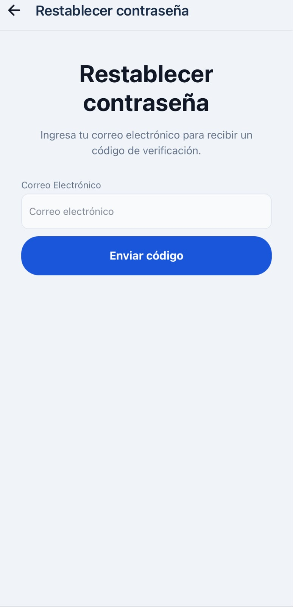

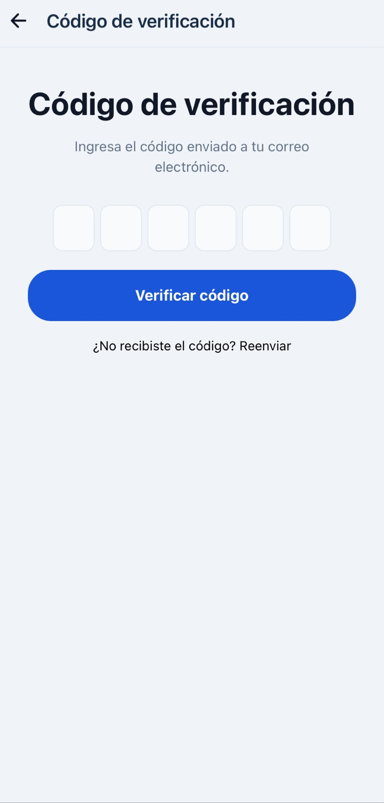

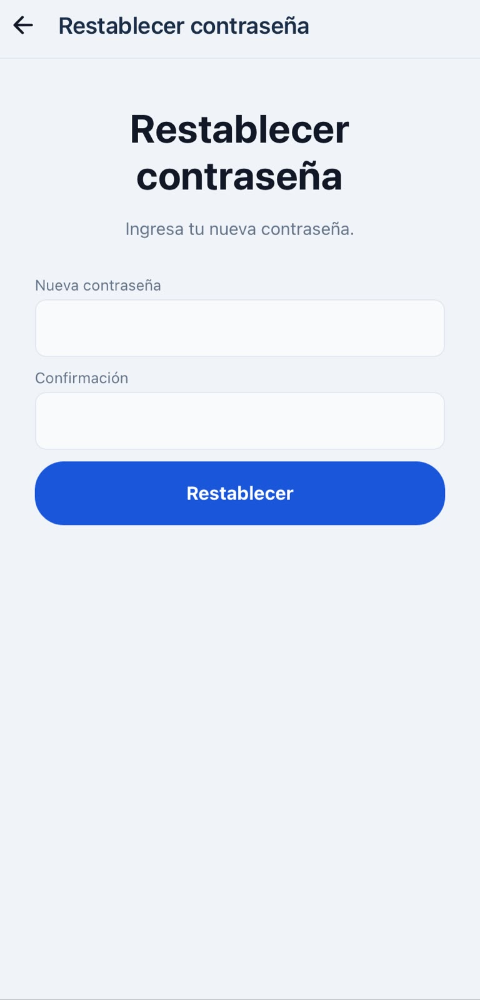

**Expected result:** The system displays the message "Password updated" and allows the user to log in with the new password.

**Notes or restrictions:** At any step, you can tap the arrow in the upper-left corner to go back to the previous screen.

## 4. Main menu of the mobile app

The app is navigated using a bottom bar with three tabs (Route, Location and Profile) and a bell icon in the upper-right corner of the map, from which alerts are viewed.

| **Section** | **How to access** | **Available for** | **Brief description** |
|---|---|---|---|
| Location / GPS tracking | "Location" tab | Parent, Student, Driver | Map with the live location of the bus, its status, speed and last update. |
| Route (My route) | "Route" tab | Parent, Student, Driver | Details of the assigned route: bus, driver, schedule, destination and stops. |
| Nearby routes | From "Route" | Student | List of other available routes near the current location. |
| Alerts | Bell icon | Parent, Student, Driver | Notifications about route or bus incidents, with filters. |
| QR code | From the main screen | Student, Driver | Generation (student) or scanning (driver) of the boarding/drop-off code. |
| Profile (My profile) | "Profile" tab | Parent, Student, Driver | My data, My family, Security, Appearance, Language, Privacy policies and About us. |

## 5. Mobile app modules

### 5.1 Real-time tracking (GPS)

| | |
|---|---|
| **Description:** | Shows on a map the live location of the school bus along with its status, speed and the time of the last update. |
| **Role that can use it:** | Parent/Guardian (parent view), Student (student view), Driver (driver view). |
| **Path:** | "Vehicle location" screen ("Location" tab), immediately after logging in. |

**Steps:**

- Log in to the app.

- On the map, look at the bus icon, which indicates the vehicle's current location.

- In the "Vehicle location" card, check: Status (for example, ACTIVE), Speed (in km/h) and Last update (time of the last data received).

- Tap the crosshair button (bottom-right of the map) to center the map on the location.

- Tap the bell icon (upper-right) to view alerts.

**Screenshot:**

- **Screen / Student view**

> 🖼️ **[IMAGE 5 GOES HERE — Student view (previous mockup, replace with a real screenshot)]**

- **Screen / Driver view**

> 🖼️ **[IMAGE 6 GOES HERE — Driver view (previous mockup, replace with a real screenshot)]**

- **Screen / Parent view**

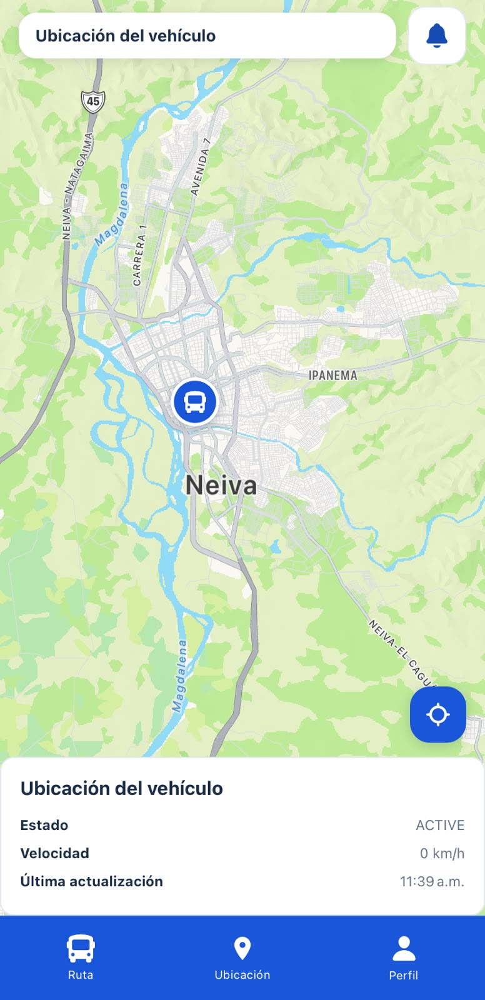

**Expected result:** The user sees the bus position, status and speed in real time.

**Notes or restrictions:** The view and some data may vary depending on the user's role (parent, student or driver). Requires an internet connection and active location permissions.

### 5.2 My route

| **Description:**          | Presents the complete details of the route assigned to the user. |
|---------------------------|------------------------------------------------------------------|
| **Role that can use it:** | Parent/Guardian, Student, Driver.                                |
| **Path:** | "Route" tab of the bottom bar. |

**Steps:**

- Tap the "Route" tab in the bottom bar.

- Check the route name, bus plate, assigned driver, final destination, address, stops and schedule.

- Tap "Nearby routes" if you want to see other available routes.

**Screenshot:**

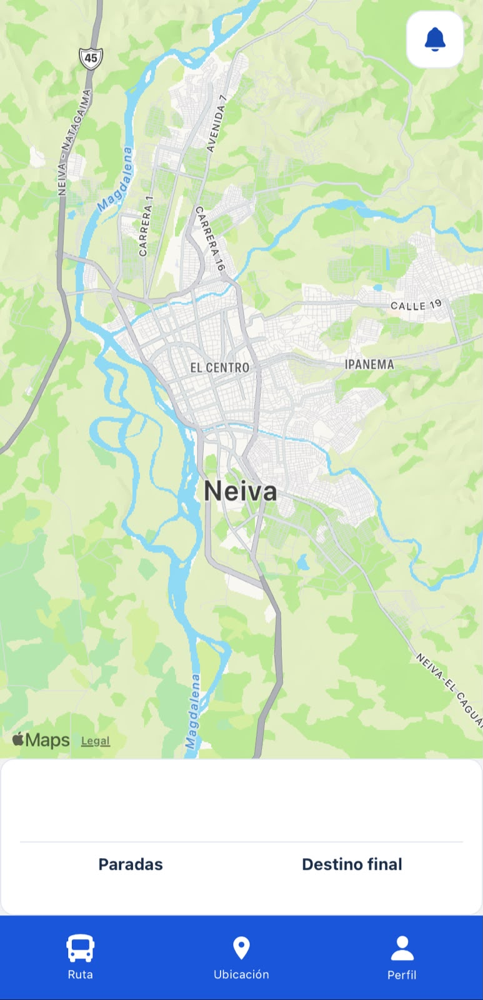

**Expected result:** The user knows all the operational details of their assigned route.

**Notes or restrictions:** The information depends on the route configured by the institution's administrator.

### 5.3 Alerts and alert filters

| **Description:**          | Lists the notifications generated during the trip (bus off route, hard braking, delayed route, bus unavailable), with time, driver and bus plate, and allows filtering them by type. |
|---------------------------|--------------------------------------------------------------------------------------------------------------------------------------------------------------------------------------|
| **Role that can use it:** | Parent/Guardian, Student, Driver.                                                                                                                                                    |
| **Path:** | Bell icon, in the upper-right corner of the main screen. |

**Steps:**

- Tap the bell icon in the upper-right corner.

- Review the list of notifications, sorted by time.

- Tap "Filter alerts" to show only the desired type of incident.

**Screenshot:**

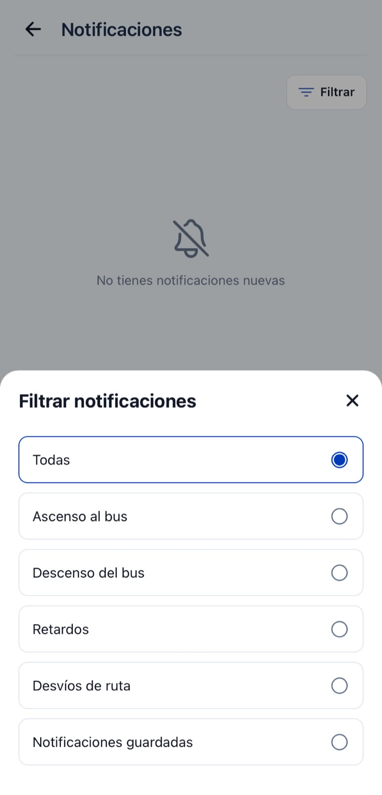

**Expected result:** The user stays informed of any relevant incident during the bus trip.

**Notes or restrictions:** Alerts depend on events generated automatically by the system during the trip.

### 5.6 Boarding and drop-off QR code

<!-- VERIFY: there is no real screenshot of this module in the current app; the text comes from the previous design (Figma). Confirm that it is still the same. -->

| **Description:**          | Generates (student) or scans (driver) the QR code that records boarding or drop-off from the bus. |
|---------------------------|---------------------------------------------------------------------------------------------------|
| **Role that can use it:** | Student (generate QR), Driver (scan QR).                                                          |
| **Path:**                 | Pop-up windows "Activate QR", "Scannable QR" and "Start scanning".                                |

**Steps:**

- Student: tap "Activate QR" and choose "Boarding" or "Drop-off"; the system generates a single-use QR code; show it to the bus reader.

- Driver: tap "Scan QRs" and then "Activate" to start the reader; scan each student's code when they board or get off.

**Screenshot:**

> 🖼️ **[IMAGE GOES HERE — screenshot pending]**  
> *Figma screen: "Scannable QR / Activate QR / Start scanning" (node-id 33:7788 · 33:7870 · 33:7886)*

**Expected result:** The student's boarding or drop-off is recorded in the system.

**Notes or restrictions:** Each QR code is single-use; after it is used, the system generates a new one for the next movement.

### 5.7 My profile

| | |
|---|---|
| **Description:** | Access point to the user's personal, family, security, appearance, language, privacy and institutional information. |
| **Role that can use it:** | Parent/Guardian, Student, Driver. |
| **Path:** | "Profile" tab of the bottom bar. |

**Steps:**

- Tap the "Profile" tab.

- Select the desired option: My data, My family, Security, Appearance, Language, Privacy policies or About us.

**Screenshot:**

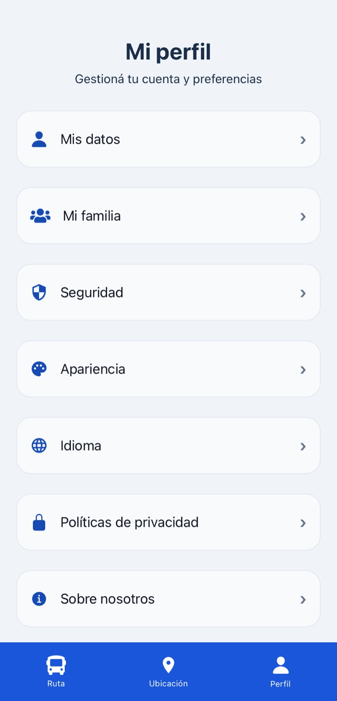

**Expected result:** The user accesses the set of configuration options for their account.

**Notes or restrictions:** None.

### 5.8 My data (includes updating phone and email)

| | |
|---|---|
| **Description:** | Allows the user to view their name, phone, email, password, address, city and school, and to update their phone and email. |
| **Role that can use it:** | Parent/Guardian, Student, Driver. |
| **Path:** | My profile \> My data. |

**Steps:**

- Go to "My data" and review the registered information.

- To update the phone: tap the edit icon next to "Phone". On the "Update phone number" screen, enter your email to verify your identity and tap "Send code"; enter the six-digit code and tap "Verify code" (if it doesn't arrive, tap "Resend"); enter the new phone number and tap "Update"; if the app asks for an additional confirmation code, enter it and tap "Verify code".

- To update the email: tap the edit icon next to "Email". On the "Update email" screen, enter your current email to verify your identity and tap "Send code"; enter the six-digit code received by email and tap "Verify code"; enter the new email and tap "Update"; if the app asks for an additional confirmation code, enter it to finish.

**Screenshot:**

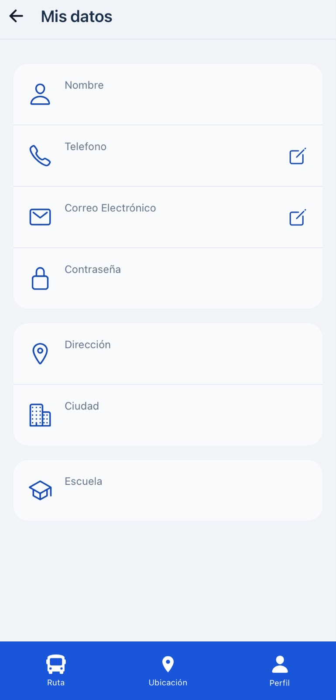

**Update phone number**
--
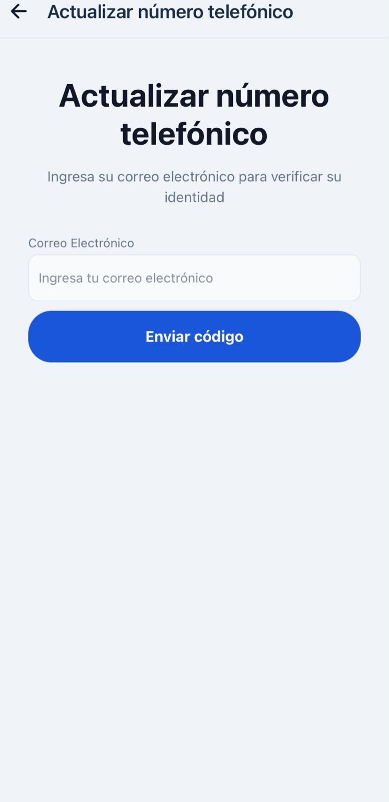

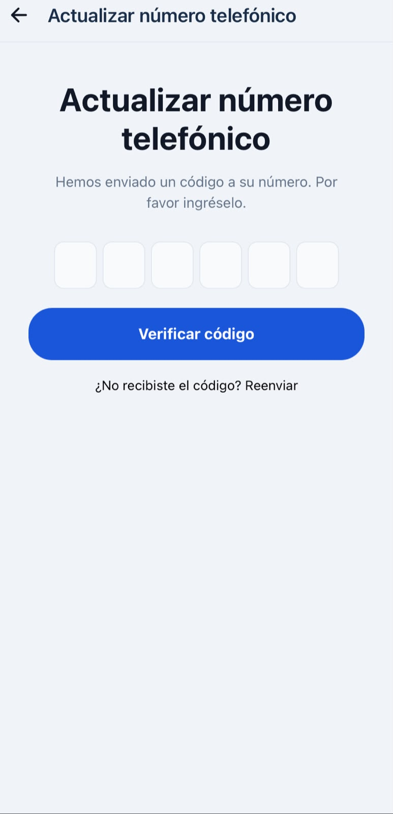

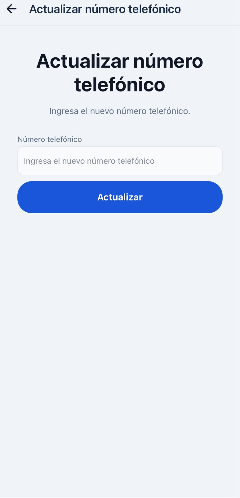

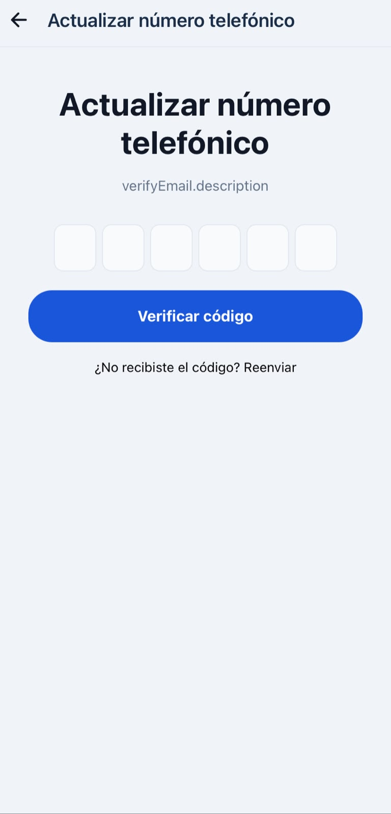

**Update email**
--
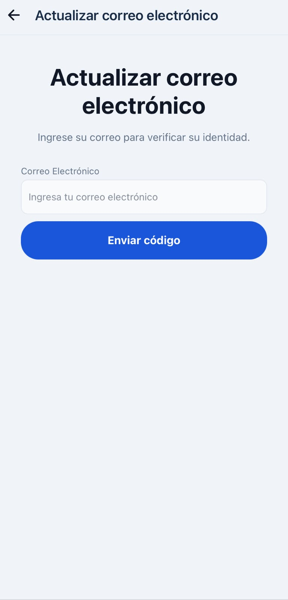

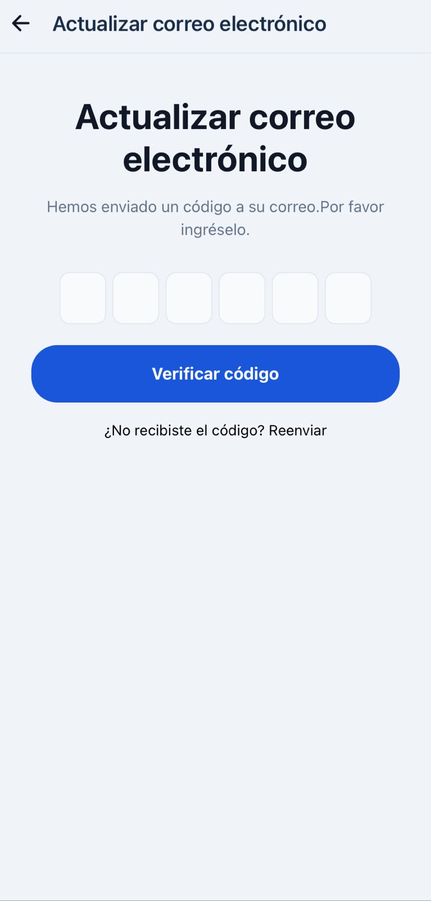

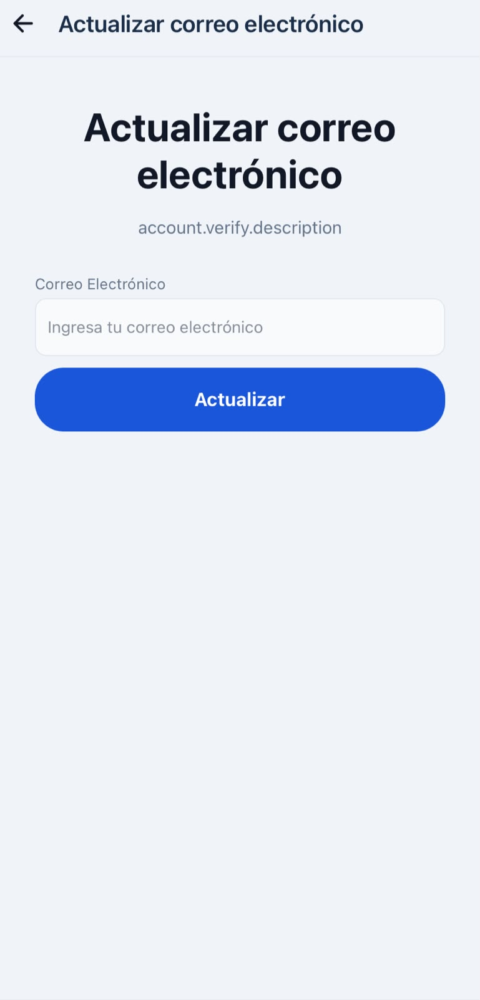

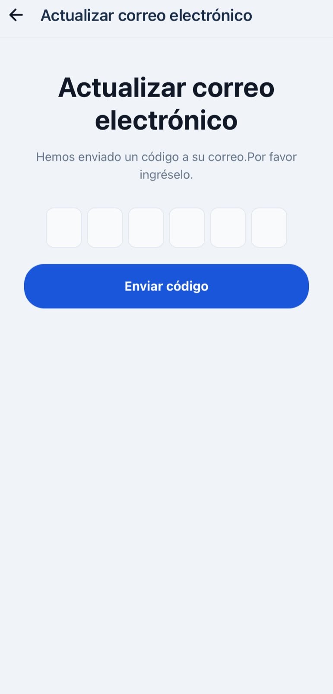

**Expected result:** The system displays the message "Number updated" or "Email updated" and reflects the new data.

**Notes or restrictions:** Only the phone and email can be edited from this screen (they have an edit icon); the password is changed from "Security". Changing the phone or email requires validating the code sent before it is completed.

### 5.9 My family

| | |
|---|---|
| **Description:** | Shows the family name, the account holder (primary guardian) and the other registered members. |
| **Role that can use it:** | Parent/Guardian. |
| **Path:** | My profile \> My family. |

**Steps:**

- Go to "My family".

- Check the family name and the "Account holder" and "Other members" sections.

**Screenshot:**

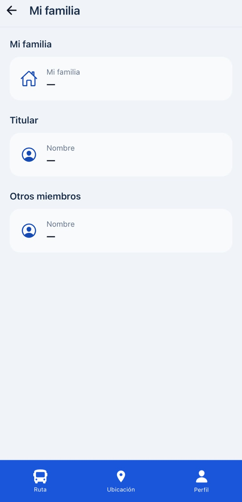

**Expected result:** The user sees the family unit associated with their account.

**Notes or restrictions:** Editing family members is done from the web panel by the administrator.

### 5.10 Security (includes changing password)

| | |
|---|---|
| **Description:** | Allows the user to enable or disable notifications and change the account password. |
| **Role that can use it:** | Parent/Guardian, Student, Driver. |
| **Path:** | My profile \> Security. |

**Steps:**

- Go to "Security".

- To receive or stop receiving notifications: use the "Enable notifications" switch.

- To change the password: tap "Change password" (edit icon) and follow the verification process using a confirmation code sent to your email.

**Screenshot:**

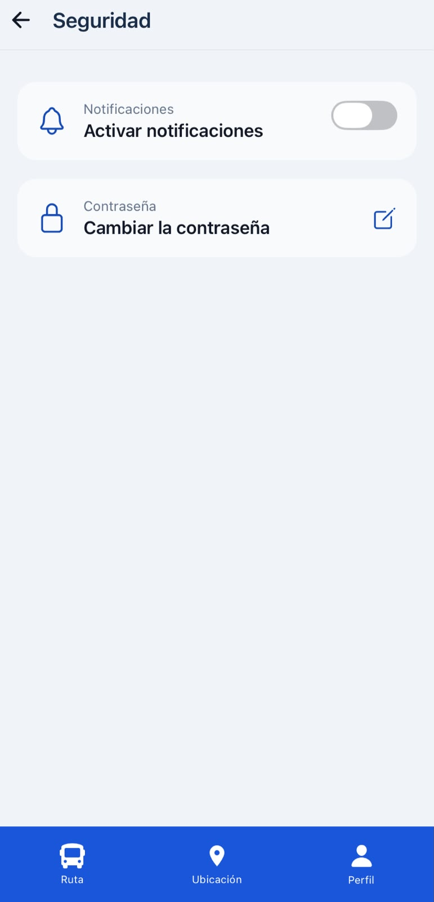

**Expected result:** The account is configured according to the options chosen by the user.

**Notes or restrictions:** Changing the password requires prior verification by email.

### 5.11 Settings: appearance and language

| | |
|---|---|
| **Description:** | Allows the user to change the app's appearance (light or dark mode and color: blue, green, yellow or red) and the language (Spanish, English, French or Portuguese). |
| **Role that can use it:** | Parent/Guardian, Student, Driver. |
| **Path:** | My profile \> Appearance / Language. |

**Steps:**

- Go to "Appearance" and select the mode ("Light" or "Dark") and the desired color ("Blue", "Green", "Yellow" or "Red").

- Go to "Language" and select the desired language.

**Screenshot:**

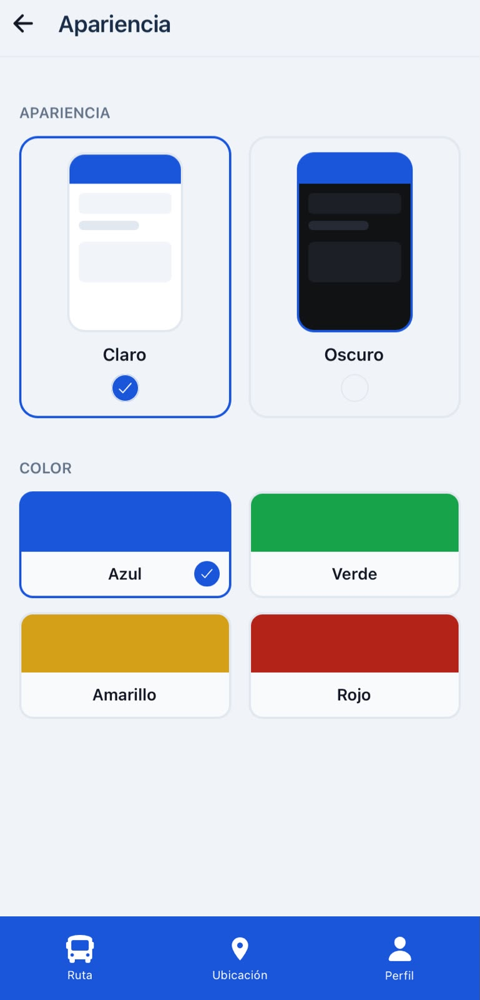

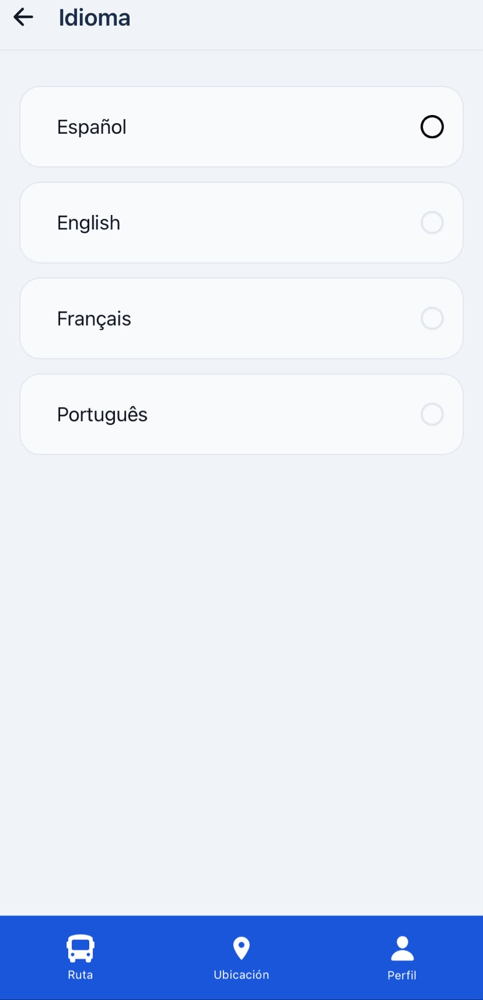

**Expected result:** The interface updates with the selected appearance or language.

**Notes or restrictions:** None.

### 5.12 About us and privacy policies

| **Description:**          | Presents institutional information about the project (mission, vision and the option to rate the app) and the policies on permissions and data privacy. |
|---------------------------|---------------------------------------------------------------------------------------------------------------------------------------------------------|
| **Role that can use it:** | Parent/Guardian, Student, Driver.                                                                                                                       |
| **Path:**                 | My profile \> Privacy policies / About us.                                                                                                              |

**Steps:**

- Go to "About us" to learn about the mission and vision, and to rate the app.

- Go to "Privacy policies" to review the use of permissions and data.

**Screenshot:**

**About us:**
--

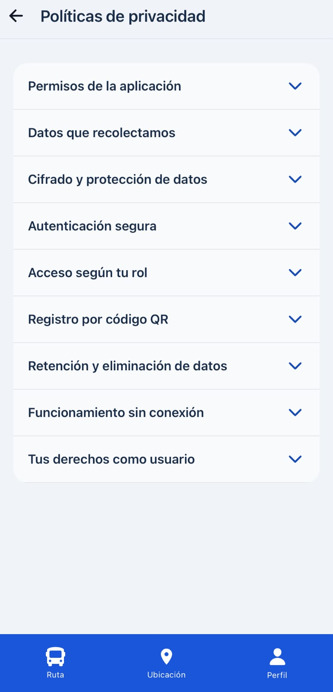

**Who we are**
--

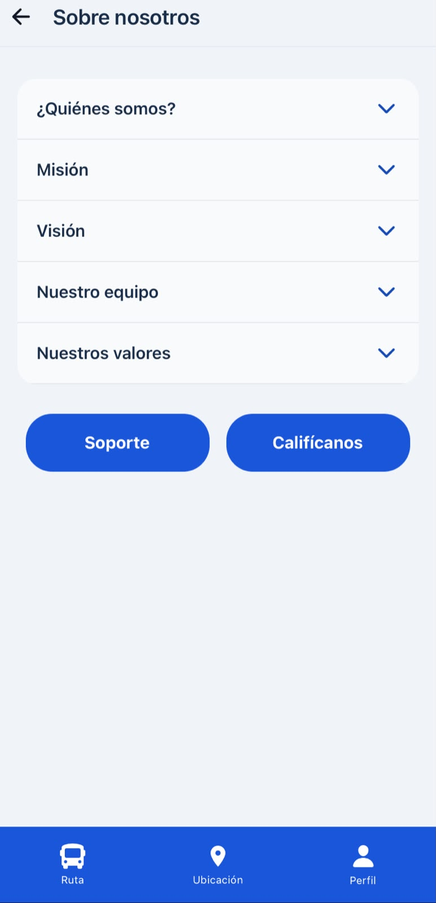

**Expected result:** The user learns about the purpose of the project and how their data is protected.

**Notes or restrictions:** None.

### 5.13 Support

| | |
|---|---|
| **Description:** | Allows the user to report a problem directly to the support team. |
| **Role that can use it:** | Parent/Guardian, Student, Driver. |
| **Path:** | My profile \> About us \> Support. |

**Steps:**

- Go to "Support".

- Write the problem in the text box "Write your message here...", below "Tell us about your problem".

- Tap "Send".

**Screenshot:**

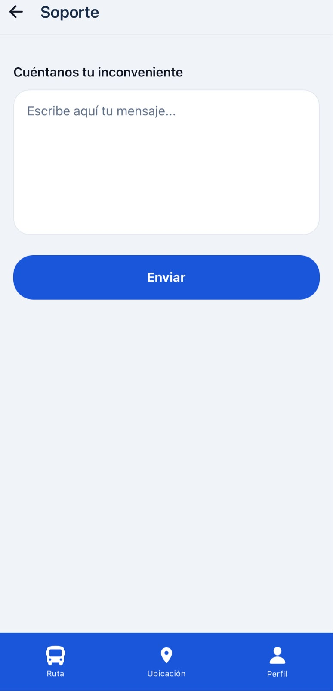

**Expected result:** The report is sent to the support team for handling.

**Notes or restrictions:** Do not include sensitive information or passwords in the support message.

### 5.1 Rate us

| | |
|---|---|
| **Description:** | Allows the user to rate the app directly. |
| **Role that can use it:** | Parent/Guardian, Student, Driver. |
| **Path:** | My profile \> About us \> Rate us. |

**Steps:**

- Go to "Rate us".

- Write a message rating the app.

- Give a score.

- Tap "Send".

**Screenshot:**

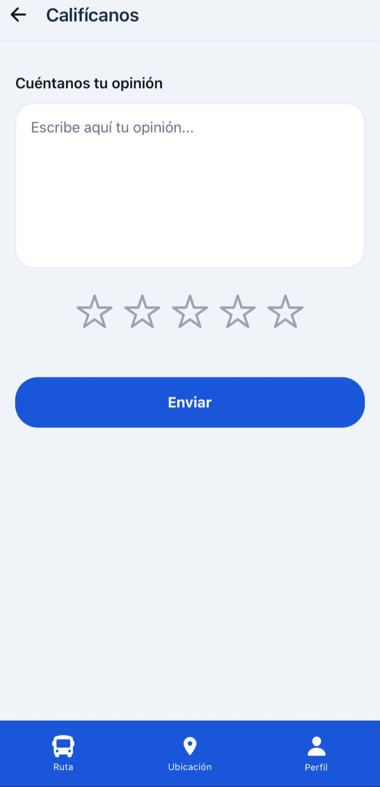

**Expected result:** The report is sent to the support team for handling.

**Notes or restrictions:** Do not include sensitive information or passwords in the support message.

## 7. Log out (mobile)

To exit safely, the user must go to "My profile" and select the log out option. The system ends the active session and returns to the Log in screen. It is recommended to always log out when using a shared device.

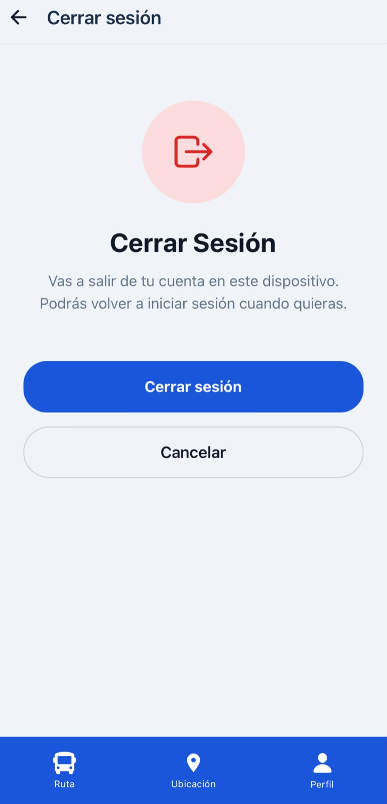

# Part II — Web app (administration panel)

Panel intended for the administrative staff of educational institutions, for managing students, guardians, drivers, families, buses, stops and routes.

## 1. Introduction to the web app

The public site (landing page) presents the Guardian Escolar system, its features (real-time GPS, administration panel, instant alerts, app for families, attendance control and secure data) and allows users to download the app or contact the sales team. From there, the administration panel login is also accessible.

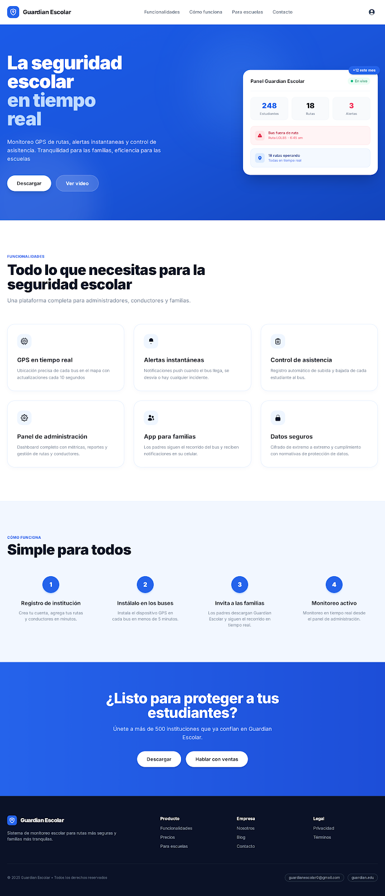

## 2. Requirements to use the web panel

- Computer with an up-to-date web browser (Chrome, Edge or Firefox) and an internet connection.

- Administrator or superadministrator username and password, previously assigned.

- Recommended screen resolution of 1366×768 or higher.

## 3. Logging in to the web panel

### 3.1 Log in (web)

| **Description:**          | Allows the administrator or superadministrator to log in to the panel with their credentials. |
|---------------------------|-----------------------------------------------------------------------------------------------|
| **Role that can use it:** | Administrator, Superadministrator.                                                            |
| **Path:**                 | "Login" screen, accessible from the landing page or directly through the system URL.          |

**Steps:**

- Enter your email in the "Email" field.

- Enter your password in the "Password" field.

- Click the "Log in" button.

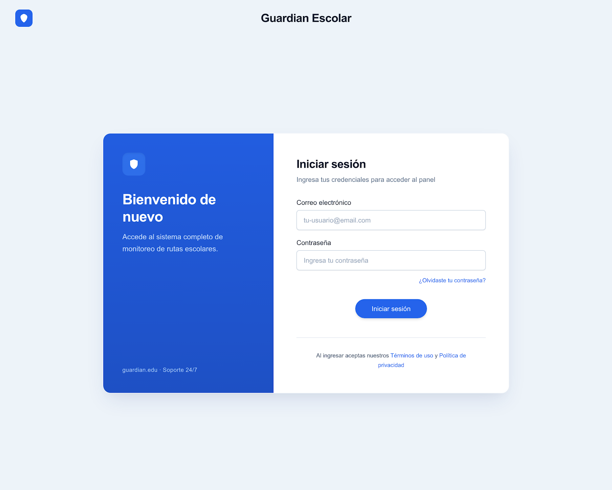

**Expected result:** The system validates the credentials and displays the administration panel corresponding to the role (Admin dashboard or Superadmin dashboard).

**Notes or restrictions:** By logging in, the user accepts the Terms of Use and the Privacy Policy. If you forgot your password, use the "Forgot your password?" link.

### 3.2 Reset password (web)

| **Description:**          | Allows the user to reset the panel access password through email verification, in three steps. |
|---------------------------|------------------------------------------------------------------------------------------------|
| **Role that can use it:** | Administrator, Superadministrator.                                                             |
| **Path:**                 | "Forgot your password?" link on the Login screen.                                              |

**Steps:**

- Step 1 of 3: enter the email you registered with and click "Send code". The system informs you that you will receive a 6-digit code.

- Step 2 of 3: enter the 6-digit code received by email and click "Validate".

- Step 3 of 3: create a new password following the security recommendations (minimum 8 characters, numbers and letters, uppercase and lowercase letters, special characters) and confirm it; click "Save new password".

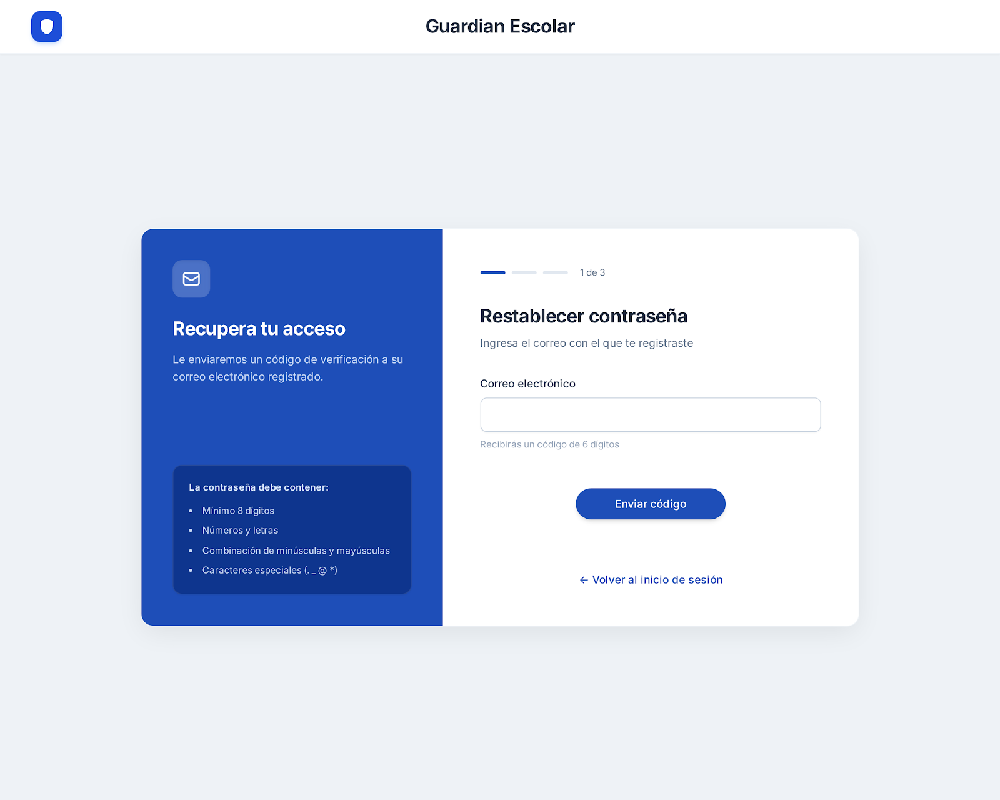
--
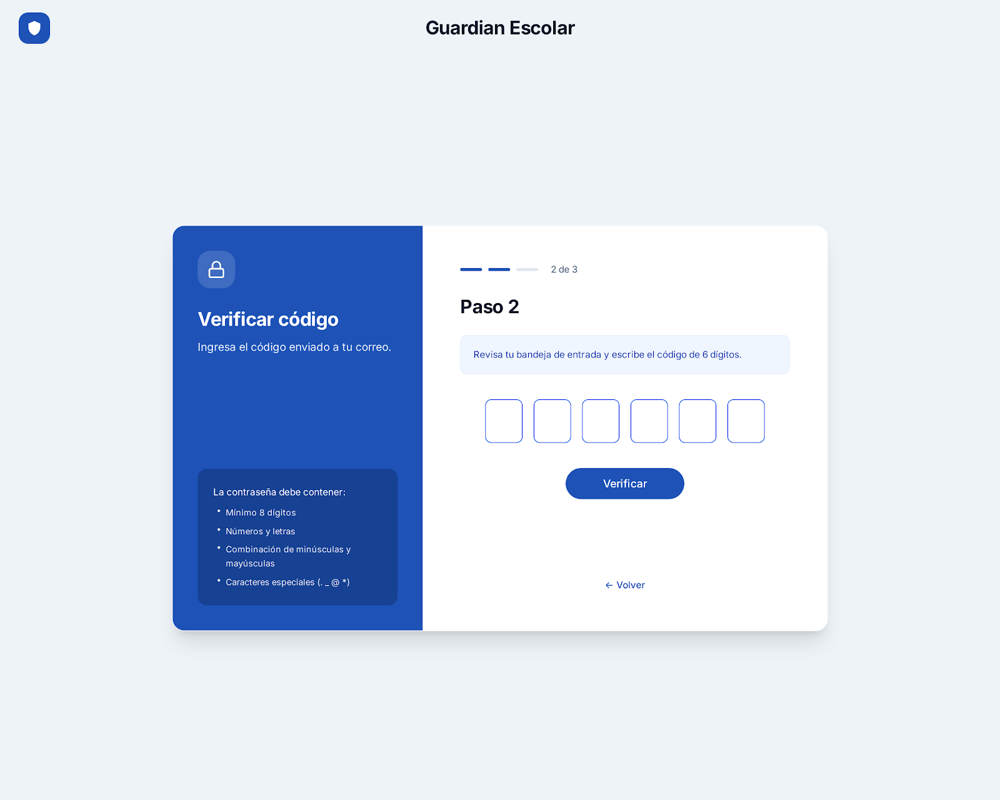
--
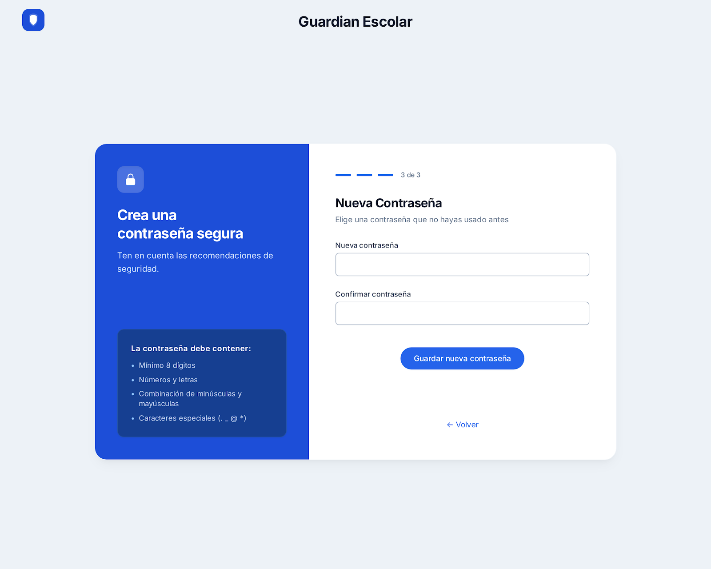

**Expected result:** The system displays the message "Password updated" and allows the user to log in with the new password.

**Notes or restrictions:** At any step, you can click "← Back to log in" to cancel the process.

## 4. Main menu and navigation of the web panel

The web panel organizes its options under the "MANAGE" menu, with the following sections (some exclusive to the Superadministrator role):

| **Section**                                          | **Available for**                 | **Brief description**                                                            |
|------------------------------------------------------|-----------------------------------|----------------------------------------------------------------------------------|
| Users (Student, Guardian, Driver, Family)            | Administrator                     | Registration and management of the people linked to school transportation.       |
| Buses                                                | Administrator                     | Registration and management of the institution's buses.                          |
| Stops                                                | Administrator                     | Registration and management of the route stops.                                  |
| Routes                                               | Administrator                     | Registration and management of school routes.                                    |
| Schools                                              | Superadministrator                | Registration and management of the educational institutions registered on the platform. |
| Administrators                                       | Superadministrator                | Registration and management of each institution's administrator accounts.        |
| Profile                                              | Administrator, Superadministrator | Personal data, security, settings and support for the panel user.                |

## 5. Web panel modules

### 5.1 Main panel — Administrator dashboard

| **Description:**          | Main view for the administrator, with metrics on active routes, registered students, today's alerts and the list of latest alerts. |
|---------------------------|------------------------------------------------------------------------------------------------------------------------------------|
| **Role that can use it:** | Administrator.                                                                                                                     |
| **Path:**                 | Initial screen after logging in as administrator.                                                                                  |

**Steps:**

- Log in with an administrator account.

- Review the metric cards: "Active routes", "Students" and "Alerts today".

- Check the "Latest alerts" list (type of incident, driver, route, plate and time).

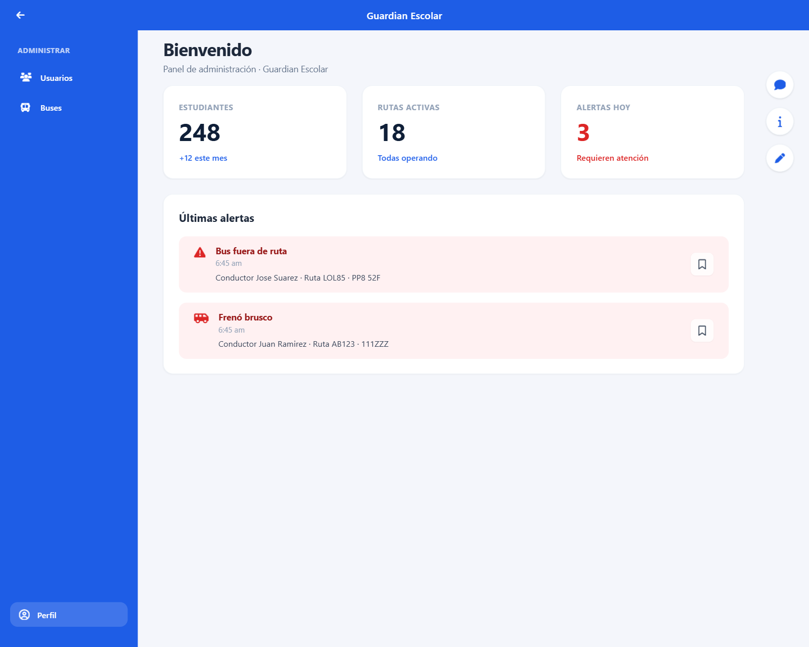

**Expected result:** The administrator gets an up-to-date overview of the status of school transportation at their institution.

**Notes or restrictions:** The data shown corresponds only to the institution of the administrator who logged in.

### 5.2 Main panel — Superadministrator dashboard

| **Description:**          | Main view for the superadministrator, with global metrics on registered schools, administrators and comments/ratings received from users. |
|---------------------------|--------------------------------------------------------------------------------------------------------------------------------------------|
| **Role that can use it:** | Superadministrator.                                                                                                                        |
| **Path:**                 | Initial screen after logging in as superadministrator.                                                                                     |

**Steps:**

- Log in with a superadministrator account.

- Review the metric cards: "Registered schools", "Administrators" and "Comments today".

- Check the "Latest comments" list sent by users, along with their rating.

**Screenshot:**

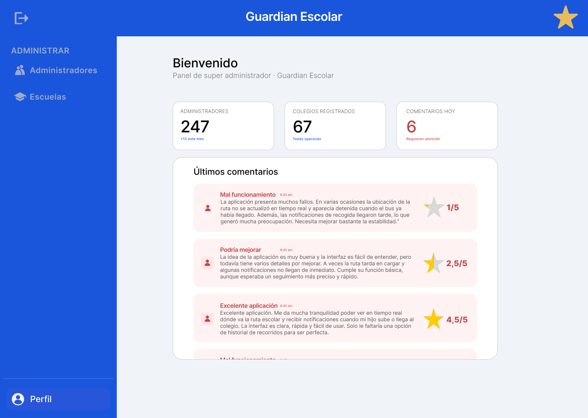

**Expected result:** The superadministrator gets an overview of how the platform is operating across all registered institutions.

**Notes or restrictions:** This view is only available to the Superadministrator role.

### 5.3 Student management

| **Description:**          | Allows the administrator to register, view, edit and see the details of the institution's students. |
|---------------------------|------------------------------------------------------------------------------------------------------|
| **Role that can use it:** | Administrator.                                                                                       |
| **Path:**                 | MANAGE \> Student.                                                                                   |

**Steps:**

- To register: fill in first names, last names, ID type and number, grade, phone, address, email and date of birth, and click "Register".

- To search: use the search box or review the "Registered students" list.

- To see details: click "Profile" on the desired student.

- To edit: open the student's details and update the necessary fields.

**Expected result:** The system displays the message "Record created successfully" or "Record updated successfully", and the student becomes available in the list.

**Notes or restrictions:** The same ID number must not be registered twice.

### 5.4 Guardian management

| **Description:**          | Allows the administrator to register, view, edit and see the details of the institution's guardians. |
|---------------------------|------------------------------------------------------------------------------------------------------|
| **Role that can use it:** | Administrator.                                                                                       |
| **Path:**                 | MANAGE \> Guardian.                                                                                  |

**Steps:**

- To register: fill in first names, last names, ID type and number, phone, address, email and date of birth, and click "Register".

- To see details: click on the guardian in the list.

- To edit: open the details and update the necessary fields.

**Screenshot:**

**Expected result:** The guardian is registered and available to be associated with a family and with one or more students.

**Notes or restrictions:** The same ID number must not be registered twice.

### 5.5 Driver management

| **Description:**          | Allows the administrator to register, view, edit and see the details of the institution's drivers. |
|---------------------------|----------------------------------------------------------------------------------------------------|
| **Role that can use it:** | Administrator.                                                                                     |
| **Path:**                 | MANAGE \> Driver.                                                                                  |

**Steps:**

- To register: fill in first names, last names, ID type and number, license number and expiration date, address, email and date of birth, and click "Register".

- To see details: click on the driver in the list (includes license status).

- To edit: open the details and update the necessary fields.

**Screenshot:**

**Expected result:** The driver is registered and available to be assigned to a bus and a route.

**Notes or restrictions:** The system warns about the validity status of the driver's license.

### 5.6 Family management

| **Description:**          | Allows the administrator to register and manage the family unit, associating a guardian with one or more students. |
|---------------------------|--------------------------------------------------------------------------------------------------------------------|
| **Role that can use it:** | Administrator.                                                                                                     |
| **Path:**                 | MANAGE \> Family.                                                                                                  |

**Steps:**

- To register: fill in the family name, guardian, student(s) and notes, and click "Register".

- To see details: click on the family in the list (guardian and other members).

- To edit: update the name, members or notes, or click "Add guardian" / "Add student" to link more members.

- To remove a member: select the member and confirm in the message "Are you sure you want to remove them from the family?".

**Screenshot:**

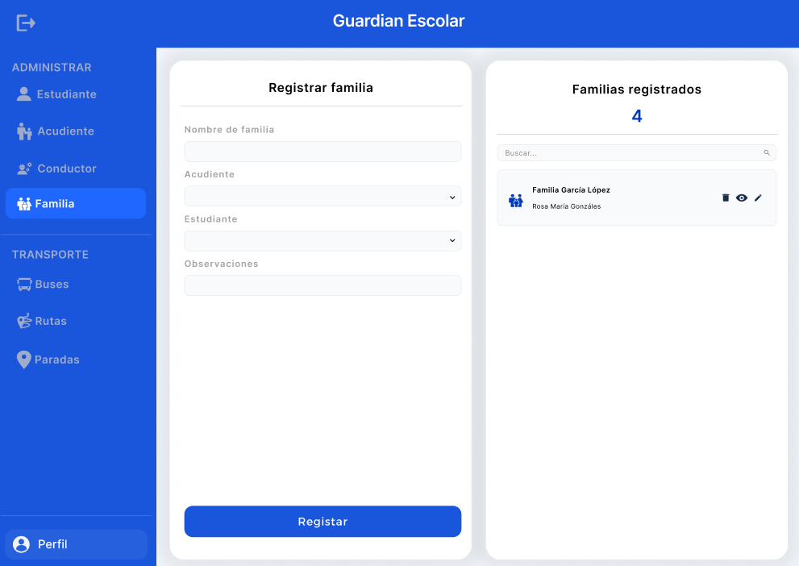

**Expected result:** The family is registered with its members correctly associated.

**Notes or restrictions:** Removing a member from the family does not delete their individual record as a student or guardian.

### 5.7 Bus management

| **Description:**          | Allows the administrator to register, view, edit and see the details of the institution's buses. |
|---------------------------|--------------------------------------------------------------------------------------------------|
| **Role that can use it:** | Administrator.                                                                                   |
| **Path:**                 | MANAGE \> Buses.                                                                                 |

**Steps:**

- To register: fill in license plate, driver, model, capacity, SOAT (mandatory insurance) validity and GPS status, and click "Register".

- To see details: click on the bus in the list (make, capacity, GPS status, driver and SOAT validity).

- To edit: open the details and update the necessary fields.

**Screenshot:**

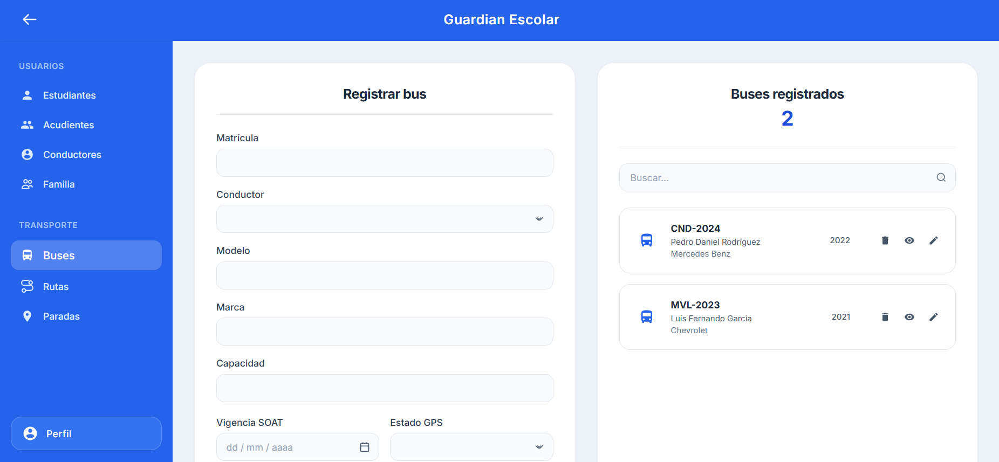

**Expected result:** The bus is registered and available to be assigned to a route.

**Notes or restrictions:** The SOAT and GPS status must be kept up to date for proper monitoring.

### 5.8 Stop management

| **Description:**          | Allows the administrator to register, view, edit and delete the school route stops. |
|---------------------------|-------------------------------------------------------------------------------------|
| **Role that can use it:** | Administrator.                                                                      |
| **Path:**                 | MANAGE \> Stops.                                                                    |

**Steps:**

- To register: fill in the stop name, city, address, latitude and longitude, and click "Register".

- To see details: click on the stop in the list.

- To edit: open the details and update the necessary fields.

- To remove a stop from a route: confirm in the message "Are you sure you want to remove the stop from the route?".

**Screenshot:**

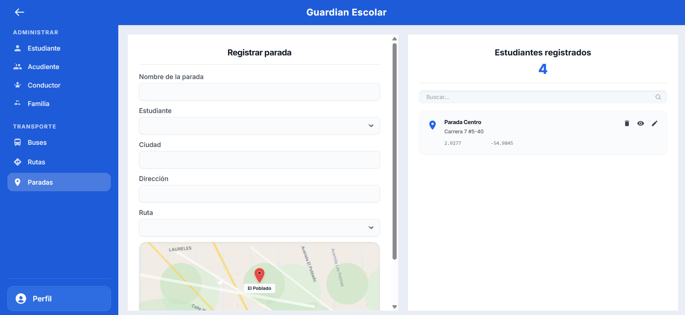

**Expected result:** The system displays the message "Record created/updated/deleted successfully" depending on the operation performed.

**Notes or restrictions:** Latitude and longitude must be exact, since they are used to draw the route on the map.

### 5.9 Route management

| **Description:**          | Allows the administrator to register, view, edit and associate stops with school routes. |
|---------------------------|------------------------------------------------------------------------------------------|
| **Role that can use it:** | Administrator.                                                                           |
| **Path:**                 | MANAGE \> Routes.                                                                        |

**Steps:**

- To register: fill in the route name, sector/neighborhood, start time, end time and destination, and click "Register".

- To see details: click on the route in the list (includes the associated stops).

- To edit: update the name, schedules or destination, and click "Add stop" to link new stops.

**Screenshot:**

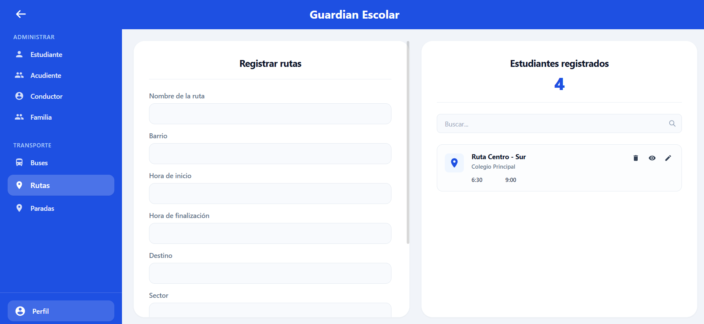

**Expected result:** The route is registered with its stops and schedules, available to be assigned to a bus and a driver.

**Notes or restrictions:** A route can have several associated stops; the order of the stops defines the route shown in the mobile app.

### 5.10 Administrator management

| **Description:**          | Allows the superadministrator to register, view and see the details of the institutions' administrator accounts. |
|---------------------------|------------------------------------------------------------------------------------------------------------------|
| **Role that can use it:** | Superadministrator.                                                                                              |
| **Path:**                 | MANAGE \> Administrators.                                                                                        |

**Steps:**

- To register: fill in first names, last names, email, ID, phone, address and date of birth, and click "Register".

- To see details: click on the administrator in the list.

**Screenshot:**

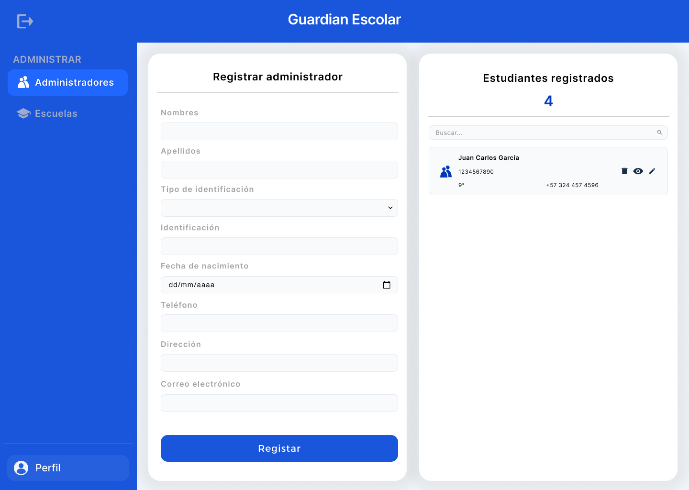

**Expected result:** The administrator account is created and available to log in to the panel of their institution.

**Notes or restrictions:** Exclusive function of the Superadministrator role.

### 5.11 School management

| **Description:**          | Allows the superadministrator to register, view, edit and see the details of the educational institutions registered on the platform. |
|---------------------------|---------------------------------------------------------------------------------------------------------------------------------------|
| **Role that can use it:** | Superadministrator.                                                                                                                   |
| **Path:**                 | MANAGE \> Schools.                                                                                                                    |

**Steps:**

- To register: fill in the school name, logo, city, address, education level, email, website and phone, and click "Register".

- To see details: click on the school in the list.

- To edit: open the details and update the necessary fields.

**Screenshot:**

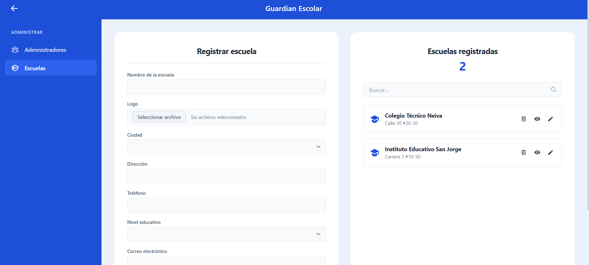

**Expected result:** The educational institution is registered and available to associate administrators, students and routes.

**Notes or restrictions:** Exclusive function of the Superadministrator role.

### 5.12 User settings (administrator profile)

| **Description:**          | Allows the user to view and update the administrator's information (name, ID, date of birth, email, address, school, phone and password), as well as change the panel's language and theme. |
|---------------------------|--------------------------------------------------------------------------------------------------------------------------------------------------------------------------------------------|
| **Role that can use it:** | Administrator, Superadministrator.                                                                                                                                                         |
| **Path:**                 | Profile \> User settings.                                                                                                                                                                  |

**Steps:**

- Go to "Profile" and review the administrator's information.

- To change the phone: go to "Change phone", enter the new number and click "Send code".

- To change the email or password: follow the email verification process (Step 1 of 3) and click "Send code".

- To change the panel's language or theme: go to "Change language" or "Change theme" and select the desired option.

**Screenshot:**

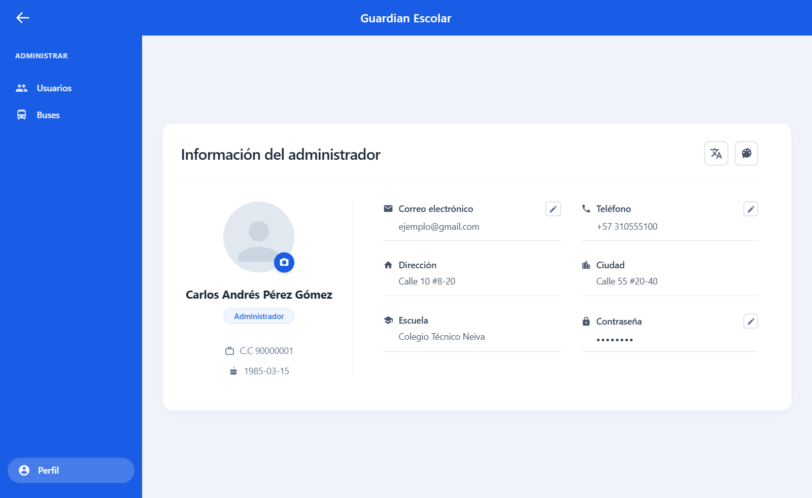

**Expected result:** The system displays a confirmation message ("Phone updated", "Email updated" or "Password reset") and reflects the new data or preferences.

**Notes or restrictions:** "Need help?" — the panel shows a support email and phone for cases in which the administrator cannot complete verification.

## 6. System messages and validations (web)

| **System message**                               | **Meaning**                                                                                              | **User action**                                         |
|--------------------------------------------------|----------------------------------------------------------------------------------------------------------|---------------------------------------------------------|
| Record created successfully                      | The new record (student, guardian, driver, bus, stop, route, etc.) was saved correctly.                  | Continue with the process.                              |
| Record updated successfully                      | The changes made to an existing record were saved.                                                       | Verify the updated information.                         |
| Record deleted successfully                      | The record was deleted from the system.                                                                  | Confirm that it no longer appears in the list.          |
| Are you sure you want to delete the record?      | Warning before a permanent deletion; the data cannot be recovered automatically.                         | Confirm only if you are sure, or cancel the action.     |
| Password updated / Password reset                | The password change was completed successfully.                                                          | Log in with the new password.                           |
| Email updated / Phone updated                    | The contact information was modified successfully.                                                       | Verify the new information in the profile.              |

## 7. Log out (web)

To exit the panel safely, the administrator or superadministrator must go to the "Profile" menu and select the log out option. The system ends the active session and returns to the Login screen. It is recommended to always log out when using a shared or public computer.

# Frequently asked questions

## Mobile app

| **Question**                                         | **Answer**                                                                                                          |
|------------------------------------------------------|---------------------------------------------------------------------------------------------------------------------|
| What do I do if I forgot my password?                | On the "Log in" screen, tap "Forgot your password?" and follow the email verification steps.                        |
| Why can't I see the bus location in real time?       | Check that the device has an active internet connection and that location permissions are enabled.                  |
| What do I do if my QR code no longer works?          | Each code is single-use; if it has already been used, the app automatically generates a new one.                    |
| How do I report a problem with the app?             | From My profile \> About us \> Support, describe the problem and tap Send.                                          |

## Web panel

| **Question**                                                   | **Answer**                                                                                                    |
|----------------------------------------------------------------|---------------------------------------------------------------------------------------------------------------|
| What do I do if I forgot my administrator password?            | On the Login screen, click "Forgot your password?" and complete the 3 verification steps.                     |
| Why can't I see the Schools or Administrators section?         | Those sections are exclusive to the Superadministrator role.                                                  |
| What happens if I delete a record by mistake?                  | The system asks for confirmation before deleting; once deleted, the data must be registered again.            |
| Who do I contact if I have a technical problem?                | Use the "Support" option in the profile, or write to guardianescolar0@gmail.com / +57 314 4308274.            |

# Glossary

| **Term**                | **Definition**                                                                                                  |
|-------------------------|-----------------------------------------------------------------------------------------------------------------|
| Guardian (Acudiente)    | Person responsible for one or more students before the educational institution.                                 |
| Route                   | Trip assigned to a school bus, with its stops, schedules and destination.                                       |
| Stop                    | Geographic point where the bus picks up or drops off students.                                                  |
| Boarding QR code        | Single-use code that a student presents to record boarding or getting off the bus.                              |
| Administrator           | Web panel user responsible for managing school transportation for an institution.                               |
| Superadministrator      | Web panel user with permissions over all institutions registered on the platform.                               |
| Alert                   | Notification generated automatically upon a trip incident (delay, deviation, hard braking, etc.).               |

# Appendices

Reference of the Figma project screens used to prepare this manual ("Mockup" file):

## Mobile canvas

| **Screen**                                   | **node-id**                 |
|----------------------------------------------|-----------------------------|
| Welcome                                      | 33:6872                     |
| Log in                                       | 33:6895                     |
| Forgot password 1 / 2 / 3                    | 33:6915 / 33:6985 / 33:6930 |
| GPS - parents / students / drivers           | 33:6788 / 33:6826 / 33:6732 |
| My route                                     | 33:7165                     |
| Nearby routes - pop-up                       | 33:7795                     |
| Stops - pop-up                               | 33:7640                     |
| Alerts / Alert filters                       | 33:7522 / 33:7454           |
| Scannable QR / Activate QR / Start scanning  | 33:7788 / 33:7870 / 33:7886 |
| My profile / My data                         | 33:7215 / 33:7276           |
| Update phone / Update email                  | 33:7324 / 33:7336           |
| My family                                    | 33:7307                     |
| Security / Change password                   | 33:7349 / 33:7370           |
| Change language / Change theme               | 33:7435 / 33:7993           |
| Support                                      | 33:7409                     |
| Privacy policies / Who we are                | 33:7384 / 33:7394           |

## Web canvas

| **Screen**                                                              | **node-id**                    |
|-------------------------------------------------------------------------|--------------------------------|
| Landing page (blue)                                                     | 5:10461                        |
| Login                                                                   | 5:10526                        |
| Forgot password (email / code / reset)                                  | 559:1779 / 561:1888 / 561:1972 |
| Admin dashboard                                                         | 5:10588                        |
| Superadmin dashboard                                                    | 5:10679                        |
| Students / Student information / Edit student                           | 5:11372 / 5:13232 / 5:13343    |
| Guardian / Guardian information / Edit guardian                         | 5:11545 / 5:13270 / 5:13369    |
| Drivers / Driver information / Edit driver                              | 5:11703 / 5:13305 / 5:13392    |
| Families / Family information / Edit family                             | 5:12188 / 5:12941 / 5:12955    |
| Buses / Bus information / Edit bus                                      | 5:12356 / 5:13420 / 5:12987    |
| Stops / Stop information / Edit stop                                    | 5:12537 / 5:13442 / 5:13010    |
| Routes / Route information / Edit route                                 | 5:12724 / 5:13458 / 5:13026    |
| Administrator management / Administrator information                    | 5:11878 / 5:13633              |
| School management / School information / Edit school                    | 5:12037 / 5:13669 / 5:13711    |
| User settings / Change phone / Change email                             | 5:10903 / 5:11012 / 5:11104    |
| Change language / Change theme                                          | 5:10947 / 5:14930              |
| Admin feedback - pop-up / Feedback sent                                 | 638:734 / 5:13629              |
