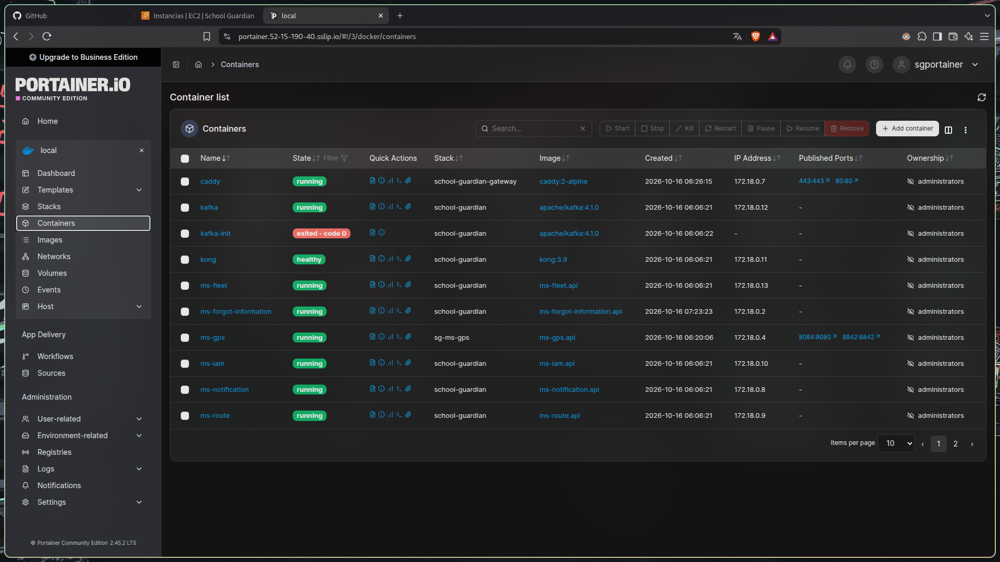
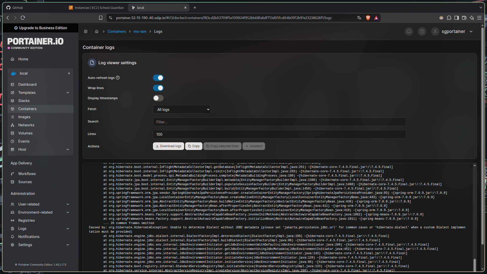
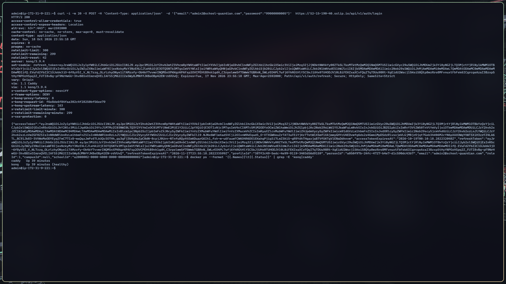
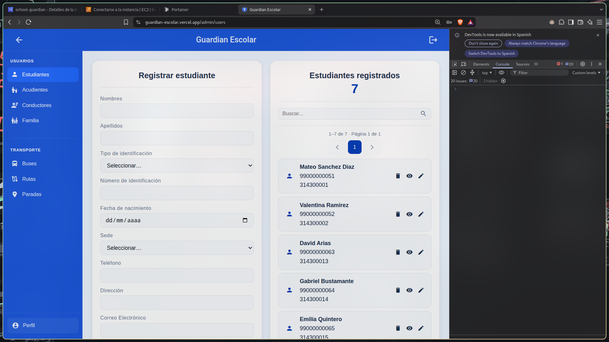
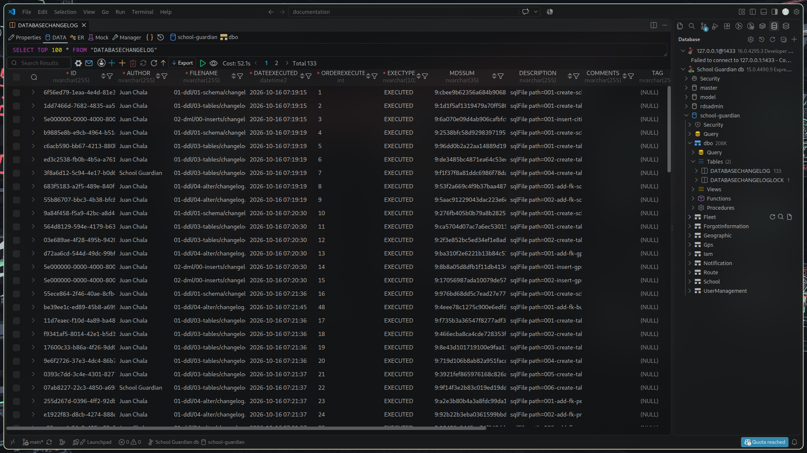

# Manual de Despliegue — School Guardian (Guardian Escolar)

> Documento operativo de despliegue de la plataforma **School Guardian** sobre AWS.
> Sigue exactamente la plantilla de **Plan de Despliegue / Runbook** solicitada.
> Las evidencias visuales del despliegue están incorporadas en la sección §5.4.

---

## Tabla de Contenido

1. [Información General y Control de Versiones](#1-información-general-y-control-de-versiones)
   - 1.1 [Ficha Técnica del Despliegue](#11-ficha-técnica-del-despliegue)
     - 1.1.1 [Identificación del sistema y versión (Release Tag)](#111-identificación-del-sistema-y-versión-release-tag)
     - 1.1.2 [Fecha, hora y ventana operativa programada](#112-fecha-hora-y-ventana-operativa-programada)
     - 1.1.3 [Entorno de destino (VPS / Staging / Producción)](#113-entorno-de-destino-vps--staging--producción)
     - 1.1.4 [Matriz de roles y responsables](#114-matriz-de-roles-y-responsables-devops-tech-lead-qa-dba)
   - 1.2 [Historial de Versiones del Documento](#12-historial-de-versiones-del-documento)
   - 1.3 [Resumen de Cambios (Release Notes)](#13-resumen-de-cambios-release-notes)
2. [Alcance, Topología y Arquitectura](#2-alcance-topología-y-arquitectura)
   - 2.1 [Componentes y Artefactos en Alcance](#21-componentes-y-artefactos-en-alcance)
   - 2.2 [Diagrama de Arquitectura de Red e Infraestructura](#22-diagrama-de-arquitectura-de-red-e-infraestructura)
   - 2.3 [Matriz de Ambientes, Direccionamiento IP y Puertos](#23-matriz-de-ambientes-direccionamiento-ip-y-puertos)
3. [Requisitos Previos y Preparación (Pre-deployment)](#3-requisitos-previos-y-preparación-pre-deployment)
   - 3.1 [Checklist de Prerrequisitos del Sistema Operativo y EC2](#31-checklist-de-prerrequisitos-del-sistema-operativo-y-ec2)
   - 3.2 [Estrategia y Ejecución de Respaldos (Backups)](#32-estrategia-y-ejecución-de-respaldos-backups)
   - 3.3 [Gestión de Variables de Entorno y Secretos](#33-gestión-de-variables-de-entorno-y-secretos)
   - 3.4 [Protocolo de Comunicación y Ventana de Mantenimiento](#34-protocolo-de-comunicación-y-ventana-de-mantenimiento)
4. [Procedimiento de Despliegue Paso a Paso (Runbook)](#4-procedimiento-de-despliegue-paso-a-paso-runbook)
   - 4.1 [Verificación y Acceso a la Plataforma Base (Portainer CE)](#41-verificación-y-acceso-a-la-plataforma-base-portainer-ce)
   - 4.2 [Despliegue y Migración de Base de Datos](#42-despliegue-y-migración-de-base-de-datos)
   - 4.3 [Despliegue y Orquestación del Stack de Aplicación](#43-despliegue-y-orquestación-del-stack-de-aplicación)
   - 4.4 [Configuración de Enrutamiento, Dominio y Certificados SSL/TLS](#44-configuración-de-enrutamiento-dominio-y-certificados-ssltls)
5. [Plan de Verificación, Pruebas y Evidencias (Smoke Tests)](#5-plan-de-verificación-pruebas-y-evidencias-smoke-tests)
   - 5.1 [Matriz de Enlaces y Endpoints de Verificación de Servicios](#51-matriz-de-enlaces-y-endpoints-de-verificación-de-servicios)
     - 5.1.1 [Acceso al panel administrativo (Portainer)](#511-acceso-al-panel-administrativo-portainer)
     - 5.1.2 [Interfaz web pública (Angular / Vercel)](#512-interfaz-web-pública-angular--vercel)
     - 5.1.3 [Endpoints de salud del Backend](#513-endpoints-de-salud-del-backend)
     - 5.1.4 [Documentación interactiva de la API (Scalar)](#514-documentación-interactiva-de-la-api-scalar)
     - 5.1.5 [Conectividad TCP directa a motor de base de datos](#515-conectividad-tcp-directa-a-motor-de-base-de-datos)
   - 5.2 [Pruebas de Humo Funcionales (Smoke Tests)](#52-pruebas-de-humo-funcionales-smoke-tests)
     - 5.2.1 [Flujo de autenticación y emisión de tokens](#521-flujo-de-autenticación-y-emisión-de-tokens)
     - 5.2.2 [Pruebas de lectura y consulta de datos](#522-pruebas-de-lectura-y-consulta-de-datos)
     - 5.2.3 [Pruebas de escritura y persistencia transaccional](#523-pruebas-de-escritura-y-persistencia-transaccional)
   - 5.3 [Inspección de Logs y Monitoreo de Recursos](#53-inspección-de-logs-y-monitoreo-de-recursos)
     - 5.3.1 [Revisión de trazas de inicio sin excepciones críticas](#531-revisión-de-trazas-de-inicio-sin-excepciones-críticas)
     - 5.3.2 [Monitoreo de consumo de CPU y memoria RAM en contenedores](#532-monitoreo-de-consumo-de-cpu-y-memoria-ram-en-contenedores)
   - 5.4 [Registro de Evidencias Visuales (Screenshots)](#54-registro-de-evidencias-visuales-screenshots)
     - 5.4.1 [Captura del panel de Portainer con contenedores Running](#541-captura-del-panel-de-portainer-con-contenedores-en-estado-running)
     - 5.4.2 [Captura de visor de logs de los servicios Backend](#542-captura-de-visor-de-logs-de-los-servicios-backend)
     - 5.4.3 [Captura de respuesta HTTP 200 de los Health Checks](#543-captura-de-respuesta-http-200-de-los-health-checks)
     - 5.4.4 [Captura de interfaz web React/Angular con consola DevTools limpia](#544-captura-de-interfaz-web-reactangular-con-consola-devtools-limpia)
     - 5.4.5 [Captura de registro de migración exitosa en base de datos](#545-captura-de-registro-de-migración-exitosa-en-base-de-datos)
6. [Anexos](#6-anexos)

---

# 1. Información General y Control de Versiones

## 1.1 Ficha Técnica del Despliegue

### 1.1.1 Identificación del sistema y versión (Release Tag)

| Campo | Valor |
|---|---|
| **Nombre del sistema** | School Guardian (Guardian Escolar) |
| **Release Tag / Versión** | `1.0.0` |
| **Fecha de build** | `2026-10-16` |
| **Repositorio Backend** | `school-guardian/backend` (rama `develop`) |
| **Repositorio Base de Datos** | `school-guardian/database` (Liquibase) |
| **Frontend Web** | `scholl-guardian-project/dvlp-front/dvlp-web` (Angular) |
| **Aplicación Móvil** | `scholl-guardian-project/dvlp-front/dvlp-movil/guardian-escolar` (React Native / Expo) |
| **Autor del despliegue** | Juan Chala |

### 1.1.2 Fecha, hora y ventana operativa programada

| Campo | Valor |
|---|---|
| **Fecha de despliegue** | `2026-10-15` |
| **Hora de inicio** | `20:00` |
| **Hora estimada de fin** | `23:00` |
| **Ventana de mantenimiento** | `20:00–23:00` |
| **Duración total** | `3 horas` |

### 1.1.3 Entorno de destino (VPS / Staging / Producción)

| Campo | Valor |
|---|---|
| **Tipo de entorno** | AWS EC2 (equivalente a VPS) — entorno de **pruebas / uso intermitente** (no productivo) |
| **Región AWS** | `us-east-2` (Ohio), zona `us-east-2a` |
| **ID de instancia** | `i-0911016bb4a900105` |
| **Sistema Operativo** | Debian GNU/Linux 13 (trixie), kernel 6.12 |
| **IP pública** | **`52.15.190.40`** (Elastic IP fija) |
| **Nombre público (DNS)** | `52-15-190-40.sslip.io` (sin comprar dominio) |

### 1.1.4 Matriz de roles y responsables (DevOps, Tech Lead, QA, DBA)

| Rol | Nombre | Responsabilidad |
|---|---|---|
| **DevOps / Infraestructura** | Juan Chala | EC2, Docker, Caddy, Kong, Portainer, Security Group |
| **Backend Developer** | Sharik Dayana Rojas, Johan Smith Santamaria, Juan Pablo Chala | Microservicios .NET / Spring Boot |
| **Frontend / Móvil** | Sharik Dayana Rojas, Johan Smith Santamaria, Juan Pablo Chala | Angular (Vercel) y React Native (EAS) |

## 1.2 Historial de Versiones del Documento

| Versión | Fecha | Autor | Descripción del cambio |
|---|---|---|---|
| 1.0 | 2026-10-15 | Juan Chala | Versión inicial del manual de despliegue |
| 1.1 | 2026-10-16 | Juan Chala | Reestructuración al formato de Plan de Despliegue; migración a Elastic IP `52.15.190.40`; integración de Portainer CE |
| 1.2 | 2026-10-18 | Juan Chala | Flujo de Portainer corregido: setup token generado por Portainer (sin credenciales ni token hardcodeados); evidencias visuales §5.4 |

## 1.3 Resumen de Cambios (Release Notes)

### 1.3.1 Nuevas funcionalidades

- **Sistema GPS completo** (`ms-gps`): servidor TCP en el puerto `8842` (protocolo VT03F) + API REST vía Kong (`/api/gps`). Persistencia en memoria (no requiere base de datos).
- **Panel de administración Portainer CE**: gestión visual de contenedores en `https://portainer.52-15-190-40.sslip.io`.
- **Servicio de información olvidada** (`ms-forgot-information`).
- **Notificaciones** (`ms-notification`) integradas con el backend vía Kafka.

### 1.3.2 Correcciones de errores (Bug fixes)

- **Web en blanco / datos no cargaban**: corregida la ruta de Kong para `/user/api/*` (mapeaba mal hacia `ms-user-management`).
- **Error 500 en `/schools` y `/schools/{id}/campuses`**: por tipo `School.Phone` (`INT` → `BIGINT`) y columnas `Latitude`/`Longitude` faltantes.
- **Columnas faltantes en `UserManagement.Person`** (`CityId`, `SchoolId`).
- **`ms-iam` caído tras reinicio** por fallo de conexión a RDS en el arranque (reinicio del contenedor resuelve).

### 1.3.3 Cambios de infraestructura y dependencias

- **IP pública pasó de dinámica a Elastic IP fija**: `52.15.190.40`. Ya no cambia al reiniciar la instancia.
- **Dominio y TLS** regenerados para `52-15-190-40.sslip.io` (Let's Encrypt vía Caddy).
- **Integración de Portainer CE** (nuevo compose `docker-compose.portainer.yml`) detrás de Caddy, sin abrir puertos nuevos.
- Base de datos migrada a **AWS RDS SQL Server Express** (free tier), separando la persistencia del servidor de aplicación.

### 1.3.4 Cambios incompatibles (Breaking changes)

- **Cambio de IP pública**: todas las variables que apuntaban a la IP anterior (`3.15.21.147`, `18.222.76.182`) deben actualizarse a `52.15.190.40` (Vercel, EAS/móvil, tracker GPS).
- **Acceso público a Portainer** por nuevo subdominio; requiere agregar `--trusted-origins` (los navegadores con versiones nuevas de Portainer 2.27.7+ rechazan login sin este flag).
- **`iam` changeset 019**: su aplicación modifica datos existentes; se marcó como `EXECUTED` manualmente tras insertar las filas requeridas (ver §4.2).

---

# 2. Alcance, Topología y Arquitectura

## 2.1 Componentes y Artefactos en Alcance

| # | Componente | Tecnología | Artefacto | Ubicación |
|---|---|---|---|---|
| 1 | Panel de administración | Portainer CE 2.45 (LTS) | `docker-compose.portainer.yml` | EC2 → `portainer:9000` |
| 2 | Reverse proxy / TLS | Caddy 2 | `deploy/Caddyfile.gateway` | EC2 → `caddy` (80/443) |
| 3 | API Gateway | Kong (DB-less) | `ms-api-gateway/kong/kong.yml` | EC2 → `kong:8000` |
| 4 | Backend API | C# .NET + Java Spring Boot | `docker-compose.yml` | EC2 → `ms-*` |
| 5 | Persistencia | SQL Server (RDS) | `database/*` (Liquibase) | AWS RDS `:1433` |
| 6 | Frontend Web | Angular SPA | `dvlp-web` | Vercel |
| 7 | App Móvil | React Native / Expo | `guardian-escolar` | EAS Build (APK/IPA) |

### 2.1.1 Panel de administración (Portainer CE)

- **Imagen:** `portainer/portainer-ce:lts` (2.45.2).
- **Despliegue:** compose propio `docker-compose.portainer.yml`, unido a la red `sg-services-network`.
- **Publicación:** **ningún puerto al host**. Caddy hace `reverse_proxy` hacia `portainer:9000`.
- **Acceso:** `https://portainer.52-15-190-40.sslip.io`.
- **Gestión:** monta `/var/run/docker.sock` para administrar los contenedores del host.
- **Flag requerido:** `--trusted-origins https://portainer.52-15-190-40.sslip.io` (evita el error *Origin invalid* detrás de proxy).
- **Setup token (primer acceso):** **no se fija en el compose** (nada hardcodeado). Portainer **genera el token solo** al arrancar y lo imprime en los logs; el procedimiento para obtenerlo está en §4.1.

### 2.1.2 Capa Frontend Web (Angular SPA / Servidor Web)

- **Framework:** Angular (build SPA) — la plantilla original menciona *Servidor Web Nginx*, pero en este despliegue el frontend se sirve como **SPA estática en Vercel** (CDN), no con Nginx propio.
- **Build:** `npx ng build --configuration spa` → `dist/school-guardian/browser`.
- **Hosting:** Vercel (`https://guardian-escolar.vercel.app`), rewrites SPA a `index.html`.
- **Variables de build (Vercel):** `API_URL`, `API_FORGOT_INFORMATION_URL`.

### 2.1.3 Capa Backend API (Java Spring Boot / C# .NET Core)

| Microservicio | Tecnología | Puerto interno |
|---|---|---|
| `ms-iam` | .NET | 8080 |
| `ms-user-management` | .NET | 8080 |
| `ms-school-management` | .NET | 8080 |
| `ms-fleet` | .NET | 8080 |
| `ms-route` | .NET | 8080 |
| `ms-notification` | .NET | 8080 |
| `ms-forgot-information` | .NET | 8080 |
| `ms-gps` | **Java Spring Boot** | 8080 (REST) / **8842** (TCP) |
| `kafka` | Apache Kafka (KRaft) | 9092 |

### 2.1.4 Capa de Persistencia (SQL Server en RDS)

- **Motor:** Microsoft SQL Server (Express) en **AWS RDS**.
- **Host:** `school-guardian.choygiky8hou.us-east-2.rds.amazonaws.com:1433`.
- **Base de datos:** `school-guardian`; usuario `sgadmin`.
- **Esquemas:** `Iam`, `UserManagement`, `School`, `Fleet`, `Route`, `Notification`, `Gps`, `Geographic`.
- **Migraciones:** **Liquibase** (la plantilla menciona Flyway/EF Core; en este proyecto se usa Liquibase 4.29 sobre el repo `database/`).
- **RDS no es accesible desde internet**: solo desde la instancia EC2 (Security Group).

## 2.2 Diagrama de Arquitectura de Red e Infraestructura

### 2.2.1 Topología del servidor (EC2)

```
                         Internet (cliente web / móvil / tracker)
                                        │
                              ┌─────────┴──────────┐
                              │  Security Group    │  abre 22, 80, 443, 8842
                              └─────────┬──────────┘
                                        │
        ┌───────────────────────────────▼───────────────────────────────┐
        │                    AWS EC2  (Debian 13)                        │
        │                    Elastic IP 52.15.190.40                     │
        │                                                                │
        │   [ Caddy ]  ← ÚNICO servicio con puertos públicos (80/443)    │
        │     ├── 52-15-190-40.sslip.io            ─► kong:8000          │
        │     └── portainer.52-15-190-40.sslip.io  ─► portainer:9000     │
        │                                                                │
        │   [ Kong (API Gateway, DB-less) ] ─► ms-*  (red interna)       │
        │   [ Kafka ] [ 7 microservicios ] [ Portainer ]                 │
        │                                                                │
        │   [ ms-gps ]  ── TCP :8842 ◄── tracker VT03F (TCP puro)        │
        └───────────────────────────────┬────────────────────────────────┘
                                        │ (SDK/SQL privado)
                                        ▼
                    [ AWS RDS — SQL Server  :1433 ]  (no público)
```

### 2.2.2 Red interna de contenedores (Docker Bridge Network)

- Red externa compartida: **`sg-services-network`** (bridge).
- Regla de oro: **ningún microservicio publica puertos al host**; se comunican por nombre de contenedor (`http://ms-iam:8080`, `kafka:9092`, `portainer:9000`, `kong:8000`).
- Caddy y Portainer se conectan a la misma red para el `reverse_proxy`.

### 2.2.3 Enrutamiento y Reverse Proxy con certificados TLS/HTTPS

- **Caddy** es la única puerta HTTPS pública (443/80). Obtiene y renueva certificados **Let's Encrypt** automáticamente (challenge HTTP-01) para los dominios `sslip.io`.
- Caddy hace `reverse_proxy` a:
  - `kong:8000` (toda la API), y
  - `portainer:9000` (panel).
- **Kong** aplica ruteo por path y valida JWT (plugin `sg-jwt`):

| Ruta pública (Kong) | Servicio destino |
|---|---|
| `/api/v1/auth`, `/api/v1/password` | `ms-iam` |
| `/user` (→ `/user/api`) | `ms-user-management` |
| `/fleet` | `ms-fleet` |
| `/school-management` | `ms-school-management` |
| `/notification` | `ms-notification` |
| `/route` | `ms-route` |
| `/api/gps` | `ms-gps` (público, sin JWT) |

## 2.3 Matriz de Ambientes, Direccionamiento IP y Puertos

| Componente | Host / IP | Puerto | Protocolo | ¿Público? |
|---|---|---|---|---|
| Caddy (HTTPS) | `52.15.190.40` / `52-15-190-40.sslip.io` | 443 | HTTPS | **Sí** |
| Caddy (HTTP→redirect) | `52.15.190.40` | 80 | HTTP | **Sí** (redirige a 443) |
| SSH (administración) | `52.15.190.40` | 22 | SSH | Sí (restringido) |
| GPS TCP (tracker VT03F) | `52.15.190.40` | 8842 | TCP puro | **Sí** |
| Portainer | vía Caddy | 9000 | HTTP (interno) | No (proxy) |
| Kong | `kong` (Docker) | 8000 / 8001 | HTTP | No |
| Microservicios `ms-*` | names Docker | 8080 | HTTP | No |
| Kafka | `kafka` | 9092 | TCP | No |
| RDS SQL Server | `…rds.amazonaws.com` | 1433 | TDS | No (solo EC2) |

---

# 3. Requisitos Previos y Preparación (Pre-deployment)

## 3.1 Checklist de Prerrequisitos del Sistema Operativo y EC2

### 3.1.1 Recursos de hardware disponibles (CPU, RAM, disco)

| Recurso | Valor real |
|---|---|
| vCPU | 2 |
| Memoria RAM | ~1.9 GiB (uso en reposo ~1.5 GiB) |
| Swap | 4 GiB (configurado para builds/imágenes) |
| Disco raíz | 7.7 GiB (uso ~22 %) |
| Sistema Operativo | Debian 13 (trixie) |

Comandos de verificación:

```bash
nproc
free -h
df -h /
```

### 3.1.2 Estado del motor Docker y socket local

| Componente | Versión |
|---|---|
| Docker Engine | 29.9.1 |
| Docker Compose | v5.6.0 |

Verificación:

```bash
docker --version
docker compose version
docker ps                       # contenedores en ejecución
ls -l /var/run/docker.sock      # socket requerido por Portainer
```

## 3.2 Estrategia y Ejecución de Respaldos (Backups)

### 3.2.1 Respaldo lógico de base de datos (Dump / Snapshot)

- **Snapshot manual de RDS** (recomendado) antes de aplicar migraciones:
  - Consola AWS → RDS → Base de datos → *Actions → Take snapshot*.
- **Respaldo lógico** vía `sqlcmd` (equivalente a dump):

```bash
docker run --rm --entrypoint /opt/mssql-tools/bin/sqlcmd \
  mcr.microsoft.com/mssql-tools:latest \
  -S school-guardian.choygiky8hou.us-east-2.rds.amazonaws.com,1433 \
  -U sgadmin -P "$MSSQL_SA_PASSWORD" -C \
  -Q "BACKUP DATABASE [school-guardian] TO DISK = N'/tmp/sg.bak'"
```

### 3.2.2 Respaldo de volúmenes persistentes de Docker

Volúmenes relevantes: `caddy-data`, `caddy-config`, `portainer-data`, `kafka-data`.

```bash
docker run --rm -v portainer-data:/data -v "$PWD":/backup alpine \
  tar czf /backup/portainer-data.tgz -C /data .
```

### 3.2.3 Respaldo de configuraciones de Stacks y variables anteriores

Antes de cada cambio de configuración se crean copias con sufijo `.bak-*`:

| Archivo | Respaldo |
|---|---|
| `ms-api-gateway/kong/kong.yml` | `kong.yml.bak-pre-user-v1`, `kong.yml.bak-pre-notif`, `kong.yml.bak-pre-ip`, `kong.yml.bak-pre-eip` |
| `deploy/Caddyfile.gateway` | `Caddyfile.gateway.bak-pre-ip`, `Caddyfile.gateway.bak-pre-eip`, `Caddyfile.gateway.bak-pre-portainer` |

## 3.3 Gestión de Variables de Entorno y Secretos

### 3.3.1 Parámetros de conexión a base de datos

Cada microservicio tiene su `.env` (no versionado) con la conexión a RDS:

```env
ConnectionStrings__DefaultConnection=Server=school-guardian.choygiky8hou.us-east-2.rds.amazonaws.com,1433;Database=school-guardian;User Id=sgadmin;Password=***;TrustServerCertificate=True;
```

### 3.3.2 Claves de firmado de tokens (JWT Secret Keys)

- `ms-iam` firma los JWT (clave RSA); Kong valida con la clave pública (`sg-jwt`).
- Las claves/claves privadas viven en los `.env` de `ms-iam` y en la configuración de Kong (no se versionan).

### 3.3.3 Límites de memoria y runtime

- Servicios .NET: `ASPNETCORE_ENVIRONMENT=Production`.
- Servicios Java: parámetros JVM `-Xmx` acotados (instancia pequeña con swap).

## 3.4 Protocolo de Comunicación y Ventana de Mantenimiento

- **Comunicación:** todo cambio se avisa al Tech Lead y QA antes de la ventana.
- **Ventana:** 2026-10-15, de 20:00 a 23:00.
- **Rollback:** restaurar backups `.bak-*` de Kong/Caddy y reiniciar contenedores; en BD, restaurar snapshot de RDS.

---

# 4. Procedimiento de Despliegue Paso a Paso (Runbook)

## 4.1 Verificación y Acceso a la Plataforma Base (Portainer CE)

1. Confirmar que Portainer está arriba:

```bash
docker ps --format '{{.Names}}\t{{.Status}}' | grep portainer
# portainer   Up ...
```

2. Levantar Portainer si no está:

```bash
cd ~/projects/school-guardian/backend
docker compose -f docker-compose.portainer.yml up -d
```

3. Acceder por navegador a:

```
https://portainer.52-15-190-40.sslip.io
```

4. En el **primer acceso**, Portainer pide un **setup token**. Obtenerlo leyendo los logs del contenedor (Portainer **lo genera solo**; no está en ningún archivo ni en el compose):

```bash
ssh -i ~/Descargas/sg-ssh.pem admin@52.15.190.40 \
  'docker logs portainer 2>&1 | grep setup_token | tail -1'
# setup_token=<hexadecimal>
```

5. Pegar el token en la pantalla y **crear el usuario administrador propio** (usuario y contraseña de **mínimo 12 caracteres** cada uno) → *Create user* → **Local** → **Connect**.

> **Flujo del setup token.** Es un mecanismo de seguridad de Portainer para impedir que cualquiera cree el primer administrador. Solo existe **mientras no haya ningún admin creado**; una vez creado, la pantalla pasa a ser un login normal y el token desaparece. Se imprime en `docker logs portainer` en **cada arranque**, por lo que **cambia al reiniciar** el contenedor y hay una ventana de ~5 minutos para usarlo (si expira o se reinicia, basta con volver a leerlo de los logs). **No se hardcodea** en el compose: este solo define `--trusted-origins`.

## 4.2 Despliegue y Migración de Base de Datos

### 4.2.1 Ejecución de scripts DDL/DML o migraciones (Liquibase)

Las migraciones viven en el repo **`database/`** (Liquibase 4.29), con un módulo por servicio (`ms-iam-db`, `ms-user-management-db`, `ms-school-db`, `ms-fleet-db`, `ms-route-db`, `ms-notification-db`, `ms-geographic-db`, `ms-gps-db`).

- **Contra SQL Server local (dev):**

```bash
cd database
docker compose up liquibase-iam liquibase-school liquibase-fleet liquibase-gps liquibase-geographic liquibase-notification liquibase-user-management
```

- **Contra RDS (despliegue):** ejecutar cada `liquibase-*` apuntando el `LIQUIBASE_COMMAND_URL` al host de RDS (`databaseName=school-guardian`).

> En este despliegue las migraciones se aplicaron al **100 %** (8 esquemas, 133 changesets, 32 tablas). El **changeset `019`** de `ms-iam-db` (DML) se desbloqueó insertando manualmente las 73 filas requeridas y marcando el changeset como `EXECUTED` con el checksum de Liquibase.

### 4.2.2 Verificación de integridad de esquemas, índices y usuarios

Correcciones no destructivas aplicadas por diferencias entre el código y las migraciones:

```sql
-- UserManagement.Person
ALTER TABLE [UserManagement].[Person] ADD [CityId]   UNIQUEIDENTIFIER NULL;
ALTER TABLE [UserManagement].[Person] ADD [SchoolId] UNIQUEIDENTIFIER NULL;

-- School.School
ALTER TABLE [School].[School]       ADD [Latitude]  DECIMAL(18,6) NULL;
ALTER TABLE [School].[School]       ADD [Longitude] DECIMAL(18,6) NULL;

-- School.SchoolCampus
ALTER TABLE [School].[SchoolCampus] ADD [Latitude]  DECIMAL(18,6) NULL;
ALTER TABLE [School].[SchoolCampus] ADD [Longitude] DECIMAL(18,6) NULL;

-- Ajuste de tipo para compatibilidad con la entidad
ALTER TABLE [School].[School] ALTER COLUMN [Phone] BIGINT NOT NULL;
```

Verificación (ejemplos):

```sql
SELECT name FROM sys.schemas;                                   -- esquemas
SELECT COUNT(*) FROM Iam.Role;                                  -- datos base
SELECT COL_LENGTH('School.School','Latitude');                  -- columna existe
```

## 4.3 Despliegue y Orquestación del Stack de Aplicación

### 4.3.1 Carga del archivo `docker-compose.yml`

Tres stacks independientes en `~/projects/school-guardian/backend`:

| Archivo | Contenido |
|---|---|
| `docker-compose.yml` | Kafka + los 7 microservicios + Kong |
| `docker-compose.gateway.yml` | Caddy (80/443) |
| `docker-compose.portainer.yml` | Portainer CE |

```bash
cd ~/projects/school-guardian/backend
docker network create sg-services-network 2>/dev/null || true
docker compose up -d                       # servicios + kong
docker compose -f docker-compose.gateway.yml   up -d   # caddy
docker compose -f docker-compose.portainer.yml up -d   # portainer
```

### 4.3.2 Inyección de variables de entorno del Stack

Cada servicio lee su `.env` (RDS, Kafka `kafka:9092`, JWT, etc.). Verificar que existan antes de levantar:

```bash
ls -1 */\.env
```

### 4.3.3 Despliegue de servicios y actualización de imágenes de contenedor

```bash
docker compose pull          # actualizar imágenes base
docker compose up -d --build # reconstruir y recrear
docker compose ps            # estado
```

## 4.4 Configuración de Enrutamiento, Dominio y Certificados SSL/TLS

1. Editar `deploy/Caddyfile.gateway` con los dos sitios:

```caddy
52-15-190-40.sslip.io {
	encode gzip
	reverse_proxy kong:8000 {
		header_up Host {host}
		header_up X-Real-IP {remote_host}
	}
	log { output stdout }
}

portainer.52-15-190-40.sslip.io {
	encode gzip
	reverse_proxy portainer:9000 {
		header_up Host {host}
		header_up X-Real-IP {remote_host}
	}
	log { output stdout }
}
```

2. Reiniciar Caddy (obtiene/renueva certificados Let's Encrypt automáticamente):

```bash
docker restart caddy
docker logs --tail 40 caddy | grep -i "certificate obtained"
# certificate obtained successfully  identifier=52-15-190-40.sslip.io
# certificate obtained successfully  identifier=portainer.52-15-190-40.sslip.io
```

3. (Opcional) Ajustar orígenes CORS en `ms-api-gateway/kong/kong.yml` y recargar:

```bash
docker restart kong
```

---

# 5. Plan de Verificación, Pruebas y Evidencias (Smoke Tests)

## 5.1 Matriz de Enlaces y Endpoints de Verificación de Servicios

### 5.1.1 Acceso al panel administrativo (Portainer)

| Recurso | URL | Resultado esperado |
|---|---|---|
| Portainer | `https://portainer.52-15-190-40.sslip.io` | HTTP 200 (pantalla de inicio de sesión) |

### 5.1.2 Interfaz web pública (Angular / Vercel)

| Recurso | URL | Resultado esperado |
|---|---|---|
| Web | `https://guardian-escolar.vercel.app` | Carga login sin errores en consola |

### 5.1.3 Endpoints de salud del Backend

> Los microservicios **no exponen** `/actuator/health` ni `/healthz` de forma pública (devuelven 404/403). La salud se verifica en la capa de contenedores y de gateway.

| Verificación | Comando | Esperado |
|---|---|---|
| Estado de contenedores | `docker ps` | Todos `Up`; `kong` → `(healthy)` |
| Gateway API viva | `POST /api/v1/auth/login` | HTTP 200 (emite token) |

### 5.1.4 Documentación interactiva de la API (Scalar)

La documentación interactiva **no se hace con Swagger UI**, sino con **Scalar**. Cada microservicio **.NET** expone Scalar en la ruta `/scalar/v1` (protegida por el JWT del gateway, Kong):

| Servicio | URL (vía Caddy) |
|---|---|
| ms-route | `https://52-15-190-40.sslip.io/route/scalar/v1` |
| ms-fleet | `https://52-15-190-40.sslip.io/fleet/scalar/v1` |
| ms-school-management | `https://52-15-190-40.sslip.io/school-management/scalar/v1` |
| ms-notification | `https://52-15-190-40.sslip.io/notification/scalar/v1` |
| ms-user-management | `https://52-15-190-40.sslip.io/user/api/scalar/v1` |

> El esquema OpenAPI en JSON queda en la misma base (`/scalar/v1` para la UI y `/openapi/v1.json` para el JSON). El acceso requiere token válido (**HTTP 401** sin autenticar). `ms-gps` es Spring Boot y no expone Scalar.

### 5.1.5 Conectividad TCP directa a motor de base de datos

Desde la instancia EC2 (RDS es privado):

```bash
timeout 6 bash -c 'cat < /dev/null > /dev/tcp/school-guardian.choygiky8hou.us-east-2.rds.amazonaws.com/1433' \
  && echo "RDS 1433 ABIERTO" || echo "RDS 1433 NO alcanzable"
```

## 5.2 Pruebas de Humo Funcionales (Smoke Tests)

### 5.2.1 Flujo de autenticación y emisión de tokens

```bash
BASE=https://52-15-190-40.sslip.io
curl -s -m 20 -X POST -H 'Content-Type: application/json' \
  -d '{"email":"admin@school-guardian.com","password":"99000000001"}' \
  "$BASE/api/v1/auth/login"
# → 200 con { "accessToken": "...", "refreshToken": "..." }
```

### 5.2.2 Pruebas de lectura y consulta de datos

Con el `accessToken`:

| Endpoint | Esperado |
|---|---|
| `GET /api/v1/auth/profile` | 200 |
| `GET /user/api/students` | 200 |
| `GET /route/api/routes` | 200 |
| `GET /fleet/api/buses` | 200 |
| `GET /school-management/api/v1/schools` | 200 |
| `GET /api/gps/devices/{imei}/connected` | 200 |

### 5.2.3 Pruebas de escritura y persistencia transaccional

- Crear/actualizar un recurso (p. ej. una ruta o un estudiante) y verificar 200/2xx + lectura posterior que confirme la persistencia en RDS.
- Caso de evidencia: `POST /route/api/routes` (crear ruta) → respuesta 2xx, verificada con `GET /route/api/routes/{id}` → **HTTP 200**.

## 5.3 Inspección de Logs y Monitoreo de Recursos

### 5.3.1 Revisión de trazas de inicio sin excepciones críticas

```bash
docker logs --tail 50 ms-iam      | grep -iE "error|exception"   # sin errores críticos
docker logs --tail 50 ms-gps      | grep -i "GPS conectado"      # tracker
```

### 5.3.2 Monitoreo de consumo de CPU y memoria RAM en contenedores

```bash
docker stats --no-stream
free -h
```

## 5.4 Registro de Evidencias Visuales (Screenshots)

> Capturas de evidencia tomadas del entorno desplegado.

### 5.4.1 Captura del panel de Portainer con contenedores en estado Running



### 5.4.2 Captura de visor de logs de los servicios Backend



### 5.4.3 Captura de respuesta HTTP 200 de los Health Checks



### 5.4.4 Captura de interfaz web React/Angular con consola DevTools limpia



### 5.4.5 Captura de registro de migración exitosa en base de datos



---

# 6. Anexos

## 6.1 Datos de acceso y direcciones

| Recurso | Valor |
|---|---|
| **Dominio API (Caddy + Kong)** | `https://52-15-190-40.sslip.io` |
| **Dominio Portainer** | `https://portainer.52-15-190-40.sslip.io` |
| **IP pública (Elastic IP)** | `52.15.190.40` |
| **Web (Vercel)** | `https://guardian-escolar.vercel.app` |
| **GPS TCP (VT03F)** | `52.15.190.40:8842` |
| **IMEI tracker** | `355468590730586` |
| **RDS Host** | `school-guardian.choygiky8hou.us-east-2.rds.amazonaws.com:1433` |
| **Instancia EC2** | `i-0911016bb4a900105` (us-east-2) |

## 6.2 Credenciales de prueba (entorno de testing)

| Rol | Usuario | Contraseña |
|---|---|---|
| Admin | `admin@school-guardian.com` | `99000000001` |
| Admin 2 | `admin2` | `99000000005` |
| Driver | `driver` | `99000000002` |
| Parent | `parent` | `99000000003` |
| Student | `student` | `99000000004` |

## 6.3 Acceso SSH

```bash
ssh -i ~/Descargas/sg-ssh.pem admin@52.15.190.40
```

## 6.4 Servicio GPS (ms-gps) — configuración del tracker VT03F

```
Servidor: 52.15.190.40
Puerto:   8842
Protocolo: TCP
```

Comando SMS de ejemplo (formato VT03F):

```text
SERVER,1,52.15.190.40,8842,0#
```

Verificación:

```bash
docker logs -f ms-gps      # esperar: "GPS conectado desde: /XX.XX.XX.XX:XXXX"
curl https://52-15-190-40.sslip.io/api/gps/devices/355468590730586/connected
# false → true al conectar el tracker
```

## 6.5 Frontend Web (Vercel) — variables de entorno

```env
API_URL=https://52-15-190-40.sslip.io
API_FORGOT_INFORMATION_URL=https://52-15-190-40.sslip.io
```

## 6.6 App Móvil (React Native + Expo) — variables y compilación

Variables EAS (entorno `production`):

```env
EXPO_PUBLIC_API_URL=https://52-15-190-40.sslip.io
EXPO_PUBLIC_FORGOT_INFORMATION_API_URL=https://52-15-190-40.sslip.io
EXPO_PUBLIC_GOOGLE_MAPS_API_KEY=***
# + variables de Notification API
```

Compilación Android (.APK) — perfil `production`:

```bash
cd dvlp-front/dvlp-movil/guardian-escolar
npx --yes eas-cli@latest build -p android --profile production --non-interactive
```

Build de referencia (EAS): **16 oct 2026, 2:39 PM** · cola 3 s · build 21 m 50 s · **total 21 m 58 s** · perfil `production`.

Compilación iOS (.IPA) — requiere cuenta Apple Developer e inicio de sesión interactivo:

```bash
npx --yes eas-cli@latest build -p ios --profile production
```

## 6.7 Troubleshooting

| Problema | Causa | Solución |
|---|---|---|
| Web login no responde / todo vacío | IP antigua (instancia cambió de IP) | Apuntar a la Elastic IP `52.15.190.40` en Vercel/EAS/móvil |
| Portainer "Origin invalid" al entrar | Portainer 2.27.7+ detrás de proxy | Flag `--trusted-origins https://portainer.52-15-190-40.sslip.io` en el compose |
| Portainer en bucle de reinicio | `--trusted-origins` sin esquema | Usar `https://host` (imagen LTS) |
| Web carga pero resto vacío | Kong `/user/*` mal mapeado + columnas BD faltantes | Ruta `/user/api` + `strip_path: true`, y columnas §4.2.2 |
| `/schools` 500 | `School.Phone` INT vs long; sin Lat/Long | `ALTER COLUMN Phone BIGINT` + columnas faltantes |
| GPS `/connected` global 404 | El endpoint no existe | Usar `/devices/{imei}/connected` |
| Tracker no conecta | Apunta a IP antigua | Reconfigurar VT03F a `52.15.190.40:8842` |
| `ms-iam` caído tras reinicio | Falla de conexión a RDS en el arranque | `docker restart ms-iam` |

## 6.8 Respaldos relevantes

`kong.yml.bak-pre-user-v1`, `kong.yml.bak-pre-notif`, `kong.yml.bak-pre-ip`, `kong.yml.bak-pre-eip`, `Caddyfile.gateway.bak-pre-ip`, `Caddyfile.gateway.bak-pre-eip`, `Caddyfile.gateway.bak-pre-portainer`.
